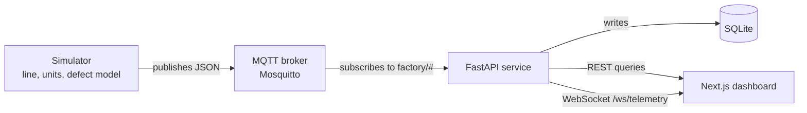

# PlantPulse

> **TODO (you write this):** One sentence saying what PlantPulse is, then two sentences on *why you built it*
> (what skills it demonstrates, why the devices are simulated). Plain words, no umbrella terms like "backend".

PlantPulse is a telemetry platform for a simulated industrial plant. I built it to gain hands-on experience with MQTT, FastAPI, SQLite, WebSockets, Next.js, pytest, and GitHub Actions. A Python simulator publishes machine data over MQTT, and a FastAPI service stores it and serves it to a Next.js dashboard. It models an 8040 membrane plant with four stages: housing, casting, assembly, and quality control (QC). The devices are simulated because I don’t have access to real industrial equipment.

> **TODO:** Add a screenshot of the dashboard's Overview page here (`docs/overview.png`, then ``).

## What it does

A simulated membrane-manufacturing plant with four stages and 11 machines. Each machine publishes telemetry over
MQTT. A FastAPI service stores everything in SQLite, pushes live updates over a WebSocket, and answers historical
queries over REST. A Next.js dashboard shows live machine status, the full journey of any individual unit, and
defect-rate analytics.

| Stage | Machines | What it does |
|---|---|---|
| Housing | 4 | Creates new units (unlimited raw material) |
| Membrane Casting | 3 | Takes units from a queue |
| Assembly | 3 | Takes units from a queue |
| QC | 1 | Tests each unit and records pass or fail |

## Architecture



### How the simulation works

- Every machine cycles through phases. It can only leave `IDLE` if it has a unit to work on: Housing creates a new
  unit, and the other stages take one from the queue in front of them. An idle machine with no input is *starved*.
- While running, a machine's vibration drifts upward. Above a threshold it faults.
- When a machine finishes a unit it records an **anomaly score**: how far its readings were from their setpoints, in
  standard deviations, summed across its readings. The score is stored in the unit's history.
- Each unit carries that history through the line. When QC tests it, the defect probability is:
  `base rate (4%) + shift-change bias (+4% at hours 6, 14, 22) + weather bias (placeholder, currently 0) + telemetry bias (sum of the unit's anomaly scores x 0.015)`,
  capped at 95%. A failed unit is attributed to the stage with the worst anomaly score. See `defect_model.py`.

### MQTT topics

| Topic | Published when |
|---|---|
| `factory/{stage}/{machine_id}/telemetry` | every machine, every 2-second tick |
| `factory/{stage}/{machine_id}/stage_event` | a machine finishes a unit's stage (not QC) |
| `factory/qc/{machine_id}/result` | QC finishes testing a unit |
| `factory/queue_depths` | every tick: units waiting in front of each stage |

### REST and WebSocket API

| Endpoint | Returns |
|---|---|
| `GET /health` | service status |
| `GET /api/machines/latest` | most recent reading per machine |
| `GET /api/queue-depths` | units waiting in front of each stage |
| `GET /api/units?limit=20` | most recently created units |
| `GET /api/units/{unit_id}` | a unit's full stage history and QC verdict |
| `GET /api/stats/defect-rate-by-hour` | defect rate grouped by hour of day |
| `GET /api/stats/defect-rate-by-stage` | failures grouped by attributed stage |
| `WS /ws/telemetry` | every MQTT message, wrapped as `{"topic": ..., "payload": ...}` |

## Running it locally

Prerequisites: Python 3.12, Node 20+ (CI uses Node 22), and a Mosquitto broker on `localhost:1883`.

```bash
# 1. Broker (Ubuntu / Debian; other systems differ)
sudo apt install mosquitto mosquitto-clients

# 2. Python environment
python -m venv venv && source venv/bin/activate
pip install -r requirements.txt

# 3. API service (creates factory.db on first start)
uvicorn main:app --port 8000

# 4. Simulator, in a second terminal (venv active)
python mqtt_publisher.py

# 5. Dashboard, in a third terminal
cd frontend
npm install
# create frontend/.env.local containing:
#   NEXT_PUBLIC_API_URL=http://localhost:8000
#   NEXT_PUBLIC_WS_URL=ws://localhost:8000/ws/telemetry
npm run dev                       # http://localhost:3000
```

The first unit needs a few minutes to travel through all four stages, so the QC results and the defect-rate charts
start empty.

| Environment variable | Default | Used by |
|---|---|---|
| `MQTT_HOST` | `localhost` | API service, simulator |
| `MQTT_PORT` | `1883` | API service, simulator |
| `CORS_ORIGINS` | `http://localhost:3000,http://127.0.0.1:3000` | API service |

## Project layout

| Path | Purpose |
|---|---|
| `config.py` | facility description: stages, machines, setpoints, cycle times |
| `units.py` | `Unit`: one product, with its journey history |
| `simulator.py` | `MachineSim`, `QCStation`, and `Line`, which wires the queues together |
| `defect_model.py` | QC defect probability |
| `mqtt_publisher.py` | runs the line and publishes every reading |
| `database.py`, `main.py` | SQLAlchemy models; FastAPI service (ingestion, WebSocket, REST) |
| `tests/` | pytest suite |
| `frontend/` | Next.js dashboard |
| `.github/workflows/ci.yml` | CI |

## Design decisions

## Design decisions

### 1. Queues between stages

**Problem:** Stages depend on each other. Casting cannot start until Housing has produced a unit, and each stage runs at a different speed.

**Choice:** Casting, Assembly, and QC each take units from a queue. A machine only starts a cycle when it can take a unit. With an empty queue it stays idle and is marked *starved*. Housing has unlimited raw material, so it always runs.

**Alternative rejected:** Letting every machine run on its own and make its own units. It is simpler, but no machine would ever wait for input, so a bottleneck could never appear.

**Tradeoff:** The queues have no size limit. Housing is faster than Casting, so the queue in front of Casting grows without bound (see Known limitations).

### 2. Units carry their own history

**Problem:** A pass or fail result does not say why a unit failed. To explain a failure I need to know which machines handled the unit and how they were behaving at the time.

**Choice:** Every unit is an object with an ID and a history. When a machine finishes a unit, it records the machine, the timestamps, its readings, and an anomaly score (how far the readings were from their setpoints). Each machine also publishes this as a `stage_event` message, and the API stores it, so the full journey of any unit is available at `GET /api/units/{id}`.

**Alternative rejected:** Storing only the QC verdict and matching it to machine telemetry by time. It is less to build, but it can only say what the plant was doing around that moment, not what happened to that specific unit.

**Tradeoff:** More data to publish and store, and every stage has to report. A failure is attributed to the stage with the worst anomaly score, which is a heuristic and not proof of the cause.

### 3. Defect probability depends on shift changes, weather, and the unit's own readings

**Problem:** A flat random defect rate gives data with nothing to analyze. The factory floor is climate-controlled, so time of day alone is not a believable cause.

**Choice:** A unit's defect probability is a base rate plus a shift-change bias, a weather bias, and a bias from the unit's own anomaly scores, capped at 95%.

**Alternative rejected:** A flat rate, or a rate that depends only on the hour of the day.

**Tradeoff:** The patterns in the data exist because I built them in, so the analytics shows effects I put there. The weather term is a placeholder (0) until a live data source is connected.

### 4. A separate QC station tests every unit

**Problem:** Production machines can flag their own work, but the plant needs one place that gives the final verdict on a unit.

**Choice:** One QC machine takes finished units from a queue, tests them, and records pass or fail, plus the defect type and the stage blamed. It acts as the ground truth that the analytics compares everything against.

**Alternative rejected:** Letting each stage discard defective units itself. The line would be simpler, but nothing downstream could learn from a unit thrown away early.

**Tradeoff:** A single QC station is one more place where units wait, and attributing a failure back to one stage is a heuristic.

### 5. MQTT between the simulator and the API

**Problem:** The simulator produces readings continuously, and several consumers (the database and the dashboard) need them without the producer knowing about each one.

**Choice:** Machines publish to MQTT topics. The API subscribes, stores each message, and forwards it to dashboards over a WebSocket. Adding another consumer needs no change to the simulator.

**Alternative rejected:** The simulator calling an HTTP endpoint every 2 seconds. It is simpler to run, but it ties the producer to the API and to every consumer behind it.

**Tradeoff:** One more service to run (the broker), and delivery guarantees to understand. The code publishes with QoS 1.

## Testing and CI

```bash
pip install pytest
pytest
```

- `tests/test_defect_model.py` covers the probability cap, the shift-change bias, and the anomaly bias.
- `tests/test_simulator.py` checks that each machine's average cycle time matches its configured value within a
  documented tolerance.

On every pull request, CI runs the following. `main` is protected, so both jobs must pass before a merge.

- **Backend:** `ruff`, an import smoke test of every module from a clean checkout, and `pytest`.
- **Frontend:** `npm run lint` and `npm run build`.

## Known limitations

This is a learning and portfolio project, not production software. The data is simulated, and I know about these
problems:

- **A faulted machine never recovers**, and the unit it was working on is stranded: never moved on, never marked scrapped.
- **No backpressure.** Housing is faster than Casting and has unlimited raw material, so queues in front of the slower stages grow without a limit.
- **Simulated cycle times run 5-11% above their configured values.** The simulation advances in 2-second ticks and every phase rounds up to the next tick. The cycle-time test tolerance documents this overhead.
- **The defect patterns exist by construction.** The probability is a formula I wrote, so the analytics "discover" effects I built in. The defect-type attribution is a heuristic (the stage with the worst anomaly score), not a causal claim. The per-machine good and reject counters come from a simple placeholder check and are not the QC verdict.
- **Weather is a placeholder constant** (0). The planned live data source is not built.
- **Clocks.** Stage timestamps use the real wall clock, and QC reads the local hour, so QC results depend on when the simulator runs. The backend also stamps rows with their arrival time, so historical data cannot be backfilled through MQTT.
- **Operational gaps:** no authentication on the API or WebSocket, the MQTT broker allows anonymous connections, and SQLite is a single-file database.
- **Dashboard queue indicators** are estimated from stage events. (Remove this line once `refactor/use-real-queue-depths` is merged.)

## Planned

Bounded queues with backpressure, fault repair, live weather data, an OEE (overall equipment effectiveness) view, and a Docker Compose deployment.