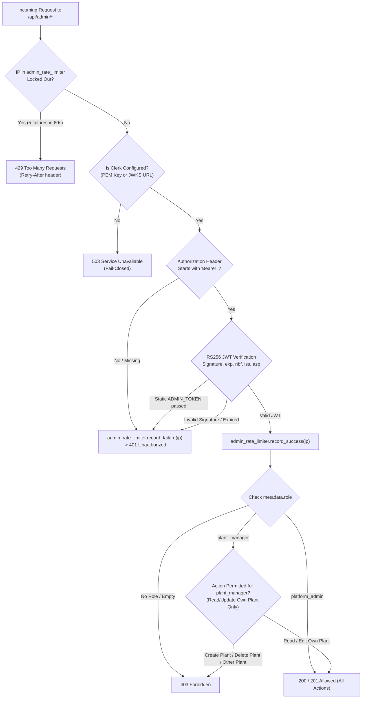

# Clerk PR 3: Retirement and Complete Removal of Static `ADMIN_TOKEN`

**Document:** `docs/design/clerk-pr3-remove-admin-token.md`  
**Status:** Plan / Ready for Implementation  
**Related Pull Requests:** [PR #96 (Clerk Login Plan)](https://github.com/Shreekanth000001/Plant-Pulse/pull/96), [PR #97 (Backend Clerk Auth)](https://github.com/Shreekanth000001/Plant-Pulse/pull/97), [PR #98 (Frontend Clerk Auth)](https://github.com/Shreekanth000001/Plant-Pulse/pull/98)  
**Branch:** `docs/plans-ingest-and-admin-token`  
**Target Delivery:** PR: `refactor(auth): deprecate and remove static ADMIN_TOKEN in favor of pure Clerk RBAC`  

---

## 1. Inventory of References to `ADMIN_TOKEN` and Admin Throttle

Every occurrence of `ADMIN_TOKEN` and the admin brute-force throttle across the repository was audited by file and line:

### 1.1 Backend References
- [`admin_auth.py#L83`](file:///home/critic-coder/project/PlantPulse/admin_auth.py#L83): `admin_rate_limiter = RateLimiter(max_attempts=5, lockout_seconds=60.0)` — IP-based sliding window lockout.
- [`admin_auth.py#L150`](file:///home/critic-coder/project/PlantPulse/admin_auth.py#L150): Docstring describing dual-mode fallback: `(b) Static ADMIN_TOKEN compare (if set, authenticated as platform_admin)`.
- [`admin_auth.py#L167-L176`](file:///home/critic-coder/project/PlantPulse/admin_auth.py#L167-L176):
  ```python
  admin_token = os.getenv("ADMIN_TOKEN")
  if not admin_token and not clerk_configured:
      raise HTTPException(
          status_code=status.HTTP_503_SERVICE_UNAVAILABLE,
          detail="Admin API disabled: ADMIN_TOKEN environment variable is not configured",
      )
  ```
- [`admin_auth.py#L193-L199`](file:///home/critic-coder/project/PlantPulse/admin_auth.py#L193-L199): Fallback static token comparison using `secrets.compare_digest(token.encode(), admin_token.encode())`.
- [`main.py#L55-L58`](file:///home/critic-coder/project/PlantPulse/main.py#L55-L58): Imports `verify_admin_token` and `verify_admin_user`.
- [`main.py#L864-L923`](file:///home/critic-coder/project/PlantPulse/main.py#L864-L923): `AdminBodyLimitMiddleware` enforcing 1 MB limit on `/api/admin`.
- [`main.py#L928`](file:///home/critic-coder/project/PlantPulse/main.py#L928): `track_viewer_activity` middleware excluding `/api/admin`.
- [`main.py#L2150-L2170`](file:///home/critic-coder/project/PlantPulse/main.py#L2150-L2170): `build_app` conditionally mounting `admin_router` based on `MOUNT_ADMIN_ENDPOINTS`.

### 1.2 Frontend References
- [`frontend/components/admin/AdminTokenEntryCard.tsx#L1-L105`](file:///home/critic-coder/project/PlantPulse/frontend/components/admin/AdminTokenEntryCard.tsx): Dedicated UI card prompting users for the static master token and storing it in `sessionStorage` (`plantpulse_admin_token`).
- [`frontend/components/admin/AdminUnmountedScreen.tsx#L39`](file:///home/critic-coder/project/PlantPulse/frontend/components/admin/AdminUnmountedScreen.tsx#L39): Instructional text snippet: `ADMIN_TOKEN=your_secure_32_character_token_here`.
- [`frontend/lib/admin-api.ts#L42`](file:///home/critic-coder/project/PlantPulse/frontend/lib/admin-api.ts#L42): URL parameter redaction: `ADMIN_TOKEN=[REDACTED]`.
- [`frontend/lib/admin-api.ts#L88`](file:///home/critic-coder/project/PlantPulse/frontend/lib/admin-api.ts#L88): Error mapping: `Admin API disabled: ADMIN_TOKEN environment variable is not configured on the server.`
- [`frontend/lib/admin-api.ts#L100-L125`](file:///home/critic-coder/project/PlantPulse/frontend/lib/admin-api.ts#L100-L125): `getAdminAuthHeaders()` retrieving `plantpulse_admin_token` from `sessionStorage`.
- [`frontend/tests/admin-api.test.ts#L104-L125`](file:///home/critic-coder/project/PlantPulse/frontend/tests/admin-api.test.ts#L104-L125): Unit test verifying 503 error handling when `ADMIN_TOKEN` is unconfigured.

### 1.3 Configuration & Documentation References
- [`docker-compose.yml#L89`](file:///home/critic-coder/project/PlantPulse/docker-compose.yml#L89): `ADMIN_TOKEN: ${ADMIN_TOKEN:-}` under `api` service environment.
- [`.env.example#L34`](file:///home/critic-coder/project/PlantPulse/.env.example#L34): `ADMIN_TOKEN=` template variable.
- [`README.md#L122, L150, L291`](file:///home/critic-coder/project/PlantPulse/README.md): Architecture documentation detailing `ADMIN_TOKEN` fallback, non-empty requirement, and 32+ character recommendation.
- [`docs/demo-script.md#L18, L23-L27, L140, L162`](file:///home/critic-coder/project/PlantPulse/docs/demo-script.md): Demonstration script instructions for entering `demo_admin_secret_token_2026_32char_len` (public demo value) into Shot 5.
- [`docs/design/hosting-feasibility.md#L293, L325`](file:///home/critic-coder/project/PlantPulse/docs/design/hosting-feasibility.md): Hosting security section requiring `MOUNT_ADMIN_ENDPOINTS=false` until `ADMIN_TOKEN` is removed.

### 1.4 Test Suite References
- [`tests/test_admin_foundation.py#L98-L113`](file:///home/critic-coder/project/PlantPulse/tests/test_admin_foundation.py#L98-L113): Tests asserting 503 when `ADMIN_TOKEN` is unset.
- [`tests/test_clerk_auth.py#L44, L156, L411, L439, L514-L528`](file:///home/critic-coder/project/PlantPulse/tests/test_clerk_auth.py): Tests verifying dual-mode authentication and backward compatibility.
- [`tests/test_viewer_throttle_secrets.py#L14, L92, L95`](file:///home/critic-coder/project/PlantPulse/tests/test_viewer_throttle_secrets.py): Imports and resets `admin_rate_limiter`.
- Other tests: `test_admin_plant_mutations.py` (line 97), `test_admin_credentials_broker.py` (line 100), `test_admin_read_endpoints.py` (line 108), `test_cors_preflight.py` (line 56), `test_broker_auth_validation.py` (lines 322, 354, 526).

---

## 2. Target Architecture After `ADMIN_TOKEN` Removal



### 2.1 Route Access Matrix After PR 3

| Endpoint | Method | Required Scope / Dependency | `platform_admin` | `plant_manager` (Assigned) | `plant_manager` (Other Plant) | Signed-in (No Role) | Static `ADMIN_TOKEN` | Anonymous |
| :--- | :--- | :--- | :---: | :---: | :---: | :---: | :---: | :---: |
| **`/api/admin/health`** | GET | `verify_admin_user` (Any admin role) | **200** | **200** | **200** | **403** | **401** | **401** |
| **`/api/admin/plants`** | GET | `verify_admin_user` (Filtered by role) | **200** (All) | **200** (Scoped) | **200** (Scoped) | **403** | **401** | **401** |
| **`/api/admin/plants/{id}`** | GET | `require_plant_access` | **200** | **200** | **403** | **403** | **401** | **401** |
| **`/api/admin/plants`** | POST | `require_platform_admin` | **201** | **403** | **403** | **403** | **401** | **401** |
| **`/api/admin/plants/{id}`** | PUT | `require_plant_access` | **200** | **200** | **403** | **403** | **401** | **401** |
| **`/api/admin/plants/{id}/credentials/rotate`** | POST | `require_plant_access` | **200** | **200** | **403** | **403** | **401** | **401** |
| **`/api/admin/plants/{id}`** | DELETE | `require_platform_admin` | **200** | **403** | **403** | **403** | **401** | **401** |

---

## 3. Core Policy & Behavior Specifications

### 3.1 401 vs 403 vs 503 Rules
- **401 Unauthorized:**
  - Returned when authentication credentials are missing, malformed, expired, cryptographically invalid, or when a client passes the retired static `ADMIN_TOKEN`.
  - Every 401 failure records an IP failure in `admin_rate_limiter`. After 5 failures within 60 seconds, the IP receives **429 Too Many Requests** with `Retry-After: 60`.
- **403 Forbidden:**
  - Returned when a user is successfully authenticated via a valid Clerk RS256 JWT, but their role is insufficient for the requested resource:
    - User with no assigned role (`metadata.role = None`) accessing any admin endpoint.
    - `plant_manager` attempting platform-level actions (`POST /api/admin/plants` or `DELETE /api/admin/plants/{id}`).
    - `plant_manager` attempting to view, edit, or rotate credentials on a plant ID other than their assigned `metadata.plant_id`.
  - 403 responses do **not** increment `admin_rate_limiter` failures because the caller is an authenticated user hitting a permission boundary, not brute-forcing cryptographic credentials.
- **503 Service Unavailable:**
  - Returned when `MOUNT_ADMIN_ENDPOINTS=true` but Clerk authentication is completely unconfigured (`CLERK_PEM_PUBLIC_KEY` and `CLERK_JWKS_URL` are both empty).
  - The server fails closed immediately without attempting any fallback.

### 3.2 Fail-Closed Principle When Clerk Is Unconfigured
In `admin_auth.py`, `verify_admin_user` evaluates configuration at invocation time:
```python
def is_clerk_configured() -> bool:
    return bool(os.getenv("CLERK_PEM_PUBLIC_KEY") or os.getenv("CLERK_JWKS_URL"))

async def verify_admin_user(request: Request, authorization: Annotated[str | None, Header()] = None) -> AdminUser:
    ip = get_client_ip(request)
    if admin_rate_limiter.is_locked_out(ip):
        raise HTTPException(status_code=429, detail="Locked out", headers={"Retry-After": "60"})
    
    if not is_clerk_configured():
        raise HTTPException(
            status_code=status.HTTP_503_SERVICE_UNAVAILABLE,
            detail="Administration is disabled: Clerk authentication is not configured on this server.",
        )
    ...
```

### 3.3 Local Development Without Real Clerk Keys & Dev Private Key Security
To allow rapid development and testing without requiring live internet access or real Clerk cloud credentials:

- **Option D1: Synthetic RSA Keypair & Local Token Minter (Recommended)**
  - Provide a standalone script: `scripts/generate_dev_clerk_token.py`.
  - **Private Key Storage & Security Boundaries:**
    - The private key is generated as an unencrypted 2048-bit PKCS#8 RSA key.
    - **Filesystem Location:** Stored exclusively in user home directory at `~/.plantpulse/dev_clerk_rsa.pem` with strict filesystem permissions (`chmod 0600`).
    - **Never in Repository or Images:** The file resides strictly outside the project repository directory and is never copied into Docker container images or committed to version control.
    - **Refusal in Hosted Environments:** The script checks runtime environment variables at invocation. If any hosted, staging, or production marker is detected (`RENDER`, `KOYEB_SERVICE_NAME`, `VERCEL`, `ORACLE_INSTANCE_ID`, `ENVIRONMENT=production`, `ENVIRONMENT=staging`), the script **immediately halts with an exit code of 1**:
      ```python
      if any(os.getenv(v) for v in ("RENDER", "KOYEB_SERVICE_NAME", "VERCEL", "ORACLE_INSTANCE_ID")) or os.getenv("ENVIRONMENT") in ("production", "staging"):
          sys.exit("SECURITY ERROR: Refusing to generate or use dev private keys in hosted/production environments.")
      ```
    - **Public Key & Tokens:** The script outputs the corresponding public key as `CLERK_PEM_PUBLIC_KEY` in `.env.local` and mints short-lived (1-hour) signed RS256 JWTs with `role="platform_admin"` or `role="plant_manager"`.
  - *Trade-off:* 100% production code parity. The FastAPI backend executes identical cryptographic RS256 signature verification in development as in cloud production. No mock bypasses exist in backend code.
- **Option D2: `DEV_BYPASS_AUTH=true` Mock Header**
  - *Rejected:* Introducing an in-code bypass flag creates severe risk of accidental activation in staging or production environments.

### 3.4 First `platform_admin` Provisioning & Demo Workflow
1. **Cloud Deployments:** The project owner creates their account via the Clerk sign-in modal. In the Clerk Dashboard, they navigate to **Users** $\rightarrow$ **Metadata** and set:
   ```json
   {
     "role": "platform_admin"
   }
   ```
2. **Automated CI/CD & Local Demos:**
   - The test suite uses synthetic RSA keys generated in-memory (`tests/test_clerk_auth.py`).
   - For demo video recording (updating `docs/demo-script.md` Shot 5), the presenter signs in through Clerk's user interface with their pre-assigned `platform_admin` account. The UI token entry card (`AdminTokenEntryCard`) is retired.

### 3.5 Role of `MOUNT_ADMIN_ENDPOINTS` in Hosted Deployments
Removing `ADMIN_TOKEN` eliminates static token brute-forcing. However, `MOUNT_ADMIN_ENDPOINTS` remains a critical security control:
- **Public Viewer Instances:** Set `MOUNT_ADMIN_ENDPOINTS=false`. Admin routes are completely unmounted from the ASGI route table, presenting a zero-attack-surface perimeter to external traffic.
- **Internal / Management Instances:** Set `MOUNT_ADMIN_ENDPOINTS=true`. Admin routes are mounted and protected exclusively by Clerk RS256 JWT verification and RBAC checks.

### 3.6 Lost Zero-Setup Admin UI & Trade-off Analysis
*Problem:* In the legacy implementation, casual developers or evaluators could clone the repo, run `docker compose up`, open `http://localhost:3000/admin`, and paste a static `ADMIN_TOKEN` without creating cloud accounts or running auxiliary tools. Removing `ADMIN_TOKEN` completely eliminates this zero-setup path.

| Evaluation Dimension | Option 1: Pure Clerk Everywhere (Recommended) | Option 2: Dev-Only Static Token (`DEV_ADMIN_TOKEN`) |
| :--- | :--- | :--- |
| **Mechanics** | Delete static token entirely. Accessing `/admin` requires either a live Clerk account or running `scripts/generate_dev_clerk_token.py` locally. | Retain optional `DEV_ADMIN_TOKEN` gated by `ENVIRONMENT == "development"`. Refuse token and error if hosted markers or non-dev env detected. |
| **Security Posture** | **Zero backdoor surface.** Production codebase contains zero static token comparison logic. Zero risk of credential leakage. | Residual risk that host-detection heuristic is bypassed by unknown hosting environment or misconfigured `ENVIRONMENT`. |
| **Evaluation Friction** | Slightly higher: Evaluators must run the local minter script to mint a dev JWT or configure Clerk keys. | Zero friction: Evaluators can immediately test admin UI locally with `DEV_ADMIN_TOKEN=demo_token`. |
| **Code Simplicity** | **High:** One single authentication path in `admin_auth.py` (RS256 JWT verify). Eliminates dual-auth branching. | **Low:** Must maintain dual-auth branches, environment inspection logic, and host-refusal guards in `admin_auth.py`. |
| **Verdict** | **Adopt Option 1.** Zero-setup local evaluation is preserved via a frictionless 1-step script `scripts/generate_dev_clerk_token.py` that populates `.env.local` automatically. | Rejected due to long-term maintenance overhead and residual production risk. |

---

## 4. Tests-First Implementation Plan

### 4.1 Core Security & RBAC Unit Tests

| Test Name | Target File | Expected Pre-Implementation Behavior | Mutation Target |
| :--- | :--- | :--- | :--- |
| `test_static_admin_token_returns_401_unauthorized` | `tests/test_clerk_auth.py` | Static `ADMIN_TOKEN` returns 200 during transition. | Re-add static token comparison in `admin_auth.py`. |
| `test_admin_returns_503_when_clerk_unconfigured` | `tests/test_clerk_auth.py` | Returns 503 only when both Clerk AND `ADMIN_TOKEN` are missing. | Invert condition to check static token. |
| `test_unauthenticated_request_returns_401` | `tests/test_clerk_auth.py` | Returns 401 with `WWW-Authenticate: Bearer`. | Remove header presence validation. |
| `test_valid_platform_admin_jwt_returns_200` | `tests/test_clerk_auth.py` | Valid JWT with `role="platform_admin"` succeeds on `/api/admin/plants`. | Corrupt role validation check. |
| `test_plant_manager_cannot_create_or_delete_plant` | `tests/test_clerk_auth.py` | `plant_manager` calling `POST /api/admin/plants` returns 403 Forbidden. | Loosen role check to allow any admin role. |
| `test_plant_manager_cannot_access_unassigned_plant` | `tests/test_clerk_auth.py` | `plant_manager` for `plant_water_district_9` accessing `/api/admin/plants/plant_demo_membrane` returns 403. | Remove `target_plant_id != user.plant_id` check. |
| `test_signed_in_user_without_role_returns_403` | `tests/test_clerk_auth.py` | JWT with valid signature but no `role` returns 403 on all `/api/admin/*` endpoints. | Treat `role=None` as default admin. |
| `test_admin_rate_limiter_locks_out_after_5_failed_jwts` | `tests/test_clerk_auth.py` | 5 invalid tokens trigger 429 lockout for 60 seconds. | Remove `admin_rate_limiter.record_failure(ip)` call. |

### 4.2 Comprehensive Inventory-Derived Test Suite Rewrite Scope

The removal of static `ADMIN_TOKEN` necessitates systematic updates across all existing test files identified in Section 1:

| Target Test File | Current Test Pattern | Required PR 3 Rewrite Action | Target Behavior |
| :--- | :--- | :--- | :--- |
| **`tests/test_clerk_auth.py`** | Dual-mode assertions; verifies static token succeeds as fallback. | Remove static token success assertions; add tests verifying static tokens return 401. | Only RS256 JWTs succeed; static tokens fail with 401 and increment rate limiter. |
| **`tests/test_admin_foundation.py`** | Lines 98–113: Asserts 503 when `ADMIN_TOKEN` is unset in env. | Rewrite to assert 503 when `CLERK_PEM_PUBLIC_KEY` and `CLERK_JWKS_URL` are both unset. | Fail-closed 503 triggered strictly by missing Clerk configuration. |
| **`tests/test_admin_plant_mutations.py`** | Uses static `{"Authorization": f"Bearer {ADMIN_TOKEN}"}` headers. | Replace auth header fixture with synthetic RS256 `platform_admin` JWT fixture. | Plant mutation endpoints verified against real cryptographic JWT verification. |
| **`tests/test_admin_credentials_broker.py`** | Static token header used for credential rotation calls. | Replace with synthetic RS256 `platform_admin` JWT fixture. | Credential rotation endpoints require `platform_admin` JWT. |
| **`tests/test_admin_read_endpoints.py`** | Static token header used for plant inventory and detail queries. | Replace with synthetic RS256 `platform_admin` and `plant_manager` JWT fixtures. | Verifies unscoped read for platform admin and scoped read for plant manager. |
| **`tests/test_cors_preflight.py`** | Verifies `OPTIONS` preflight with static auth headers. | Update expected `access-control-allow-headers` to include Clerk auth headers. | Preflight succeeds with JWT headers. |
| **`tests/test_broker_auth_validation.py`** | Lines 322, 354, 526: Uses static token to invoke admin auth sync. | Update test fixtures to authenticate via synthetic `platform_admin` JWT. | Broker auth sync endpoints authenticated via JWT. |
| **`tests/test_viewer_throttle_secrets.py`** | Lines 14, 92–95: Tests admin brute-force lockout using static string tokens. | Update brute-force tests to submit 5 malformed JWTs to verify 429 lockout. | `admin_rate_limiter` lockout verified against invalid JWT attempts. |
| **`frontend/tests/admin-api.test.ts`** | Lines 104–125: Asserts 503 error text mentions `ADMIN_TOKEN`. | Update assertion to expect Clerk unconfigured error message. | Frontend error mapping tests align with Clerk error contracts. |

---

## 5. Frontend Migration Plan

1. **Retire `AdminTokenEntryCard.tsx`:** Remove static token input form. Replace with Clerk `<SignIn />` button or a role-based access status banner:
   - If signed out: Render Clerk sign-in card.
   - If signed in without role: Render "Access Pending: Your account has no assigned administrative role. Contact platform owner."
   - If signed in as `plant_manager`: Render plant management console scoped to their assigned plant.
   - If signed in as `platform_admin`: Render full multi-plant administration portal.
2. **Update `AdminUnmountedScreen.tsx`:** Remove `ADMIN_TOKEN` setup instructions. Update text to reflect Clerk PEM/JWKS environment variables.
3. **Clean `admin-api.ts`:** Remove `sessionStorage.getItem("plantpulse_admin_token")`. All admin fetch requests retrieve the Clerk session token via `window.Clerk.session.getToken()`.

---

## 6. PR Split & Rollback Plan

### PR Execution Split
- **PR 3.1: Backend `ADMIN_TOKEN` Retirement & Pure Clerk RBAC**
  - Delete `ADMIN_TOKEN` evaluation from `admin_auth.py`.
  - Update `verify_admin_user` and `verify_admin_token` to reject static tokens with 401.
  - Update `docker-compose.yml`, `.env.example`, and backend test suite.
- **PR 3.2: Frontend UI Clean-up & Demo Script Alignment**
  - Remove `AdminTokenEntryCard` and session-storage token passing.
  - Update `docs/demo-script.md` Shot 5 to use Clerk authentication.
  - Remove all remaining static admin token documentation from `README.md`.

### Rollback Strategy
If Clerk authentication encounters an upstream outage or configuration mismatch during migration:
1. Revert PR 3.1 via `git revert`.
2. Temporary fallback to dual-mode auth is restored by setting `ADMIN_TOKEN` in `.env`.
3. Production downtime is avoided.
