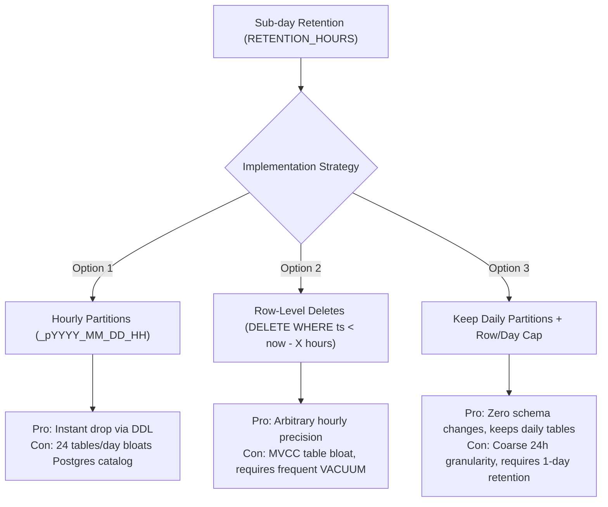

# Design Document: Cloud Hosting Feasibility & Free-Tier Architecture for PlantPulse

**Target Document:** `docs/design/hosting-feasibility.md`  
**Branch:** `docs/final-phase`  
**Status:** Feasibility Research & Architectural Analysis  
**Date:** 2026-10-22  

---

## 1. Executive Summary

PlantPulse is currently packaged as a multi-container Docker Compose application consisting of five interdependent services:
1. `api`: FastAPI backend with an internal async MQTT ingest engine, WebSockets, and in-memory caches.
2. `broker`: Eclipse Mosquitto 2.0 MQTT broker with file-based dynamic credentials (`passwd`) and ACLs (`acl.conf`).
3. `postgres`: PostgreSQL 16 database with transactional migrations (Alembic) and partitioned history storage.
4. `dashboard`: Next.js 16 (App Router) web interface with Turbopack and Clerk authentication.
5. `simulator`: Python factory simulation generating real-time signals (11 machines across 2 plants).

Deploying PlantPulse to cloud hosting requires analyzing whether modern **free tiers** can sustain long-lived stateful protocols (WebSockets, continuous outbound MQTT subscriptions, high-frequency database writes) or whether platform architectural assumptions (shared PID namespaces, in-memory stores, single uvicorn worker) break under distributed or serverless cloud environments.

---

## 2. Official Documentation Sources, Quotes & Retrieval Dates

All provider specifications cited in this document were retrieved directly from official provider documentation on **2026-10-22**. Each claim is backed by an exact quote under 15 words:

| Category | Provider & Tier | Official Source & URL | Retrieval Date | Exact Quote (< 15 words) |
| :--- | :--- | :--- | :--- | :--- |
| **Python Host** | Oracle Cloud (OCI Always Free) | [OCI Free Tier Resources](https://docs.oracle.com/en-us/iaas/Content/FreeTier/freetier_topic-Always_Free_Resources.htm) | 2026-10-22 | *"Idle Always Free compute instances may be reclaimed by Oracle."* |
| **Python Host** | Koyeb (Eco-Nano Free) | [Koyeb Pricing](https://www.koyeb.com/pricing)   [Koyeb Scale to Zero](https://www.koyeb.com/docs/run-and-scale/scale-to-zero) | 2026-10-22 | *"Koyeb requires a credit card during sign-up to prevent fraud and abuse."*   *"held connection (e.g., a WebSocket or HTTP/2 stream) from the Internet"* |
| **Python Host** | Render (Free Web Service) | [Render Free Plans](https://render.com/docs/free) | 2026-10-22 | *"spin down after 15 minutes of inactivity"* |
| **Python Host** | PythonAnywhere (Beginner) | [PythonAnywhere Account Types](https://help.pythonanywhere.com/pages/AccountTypes/)   [PythonAnywhere Allowlist](https://help.pythonanywhere.com/pages/API-allowlist/) | 2026-10-22 | *"Free accounts have restricted outbound internet access"* |
| **Hosted MQTT** | HiveMQ Cloud (Serverless) | [HiveMQ Serverless Retirement](https://www.hivemq.com/docs/cloud/serverless-retirement.html) | 2026-10-22 | *"HiveMQ is retiring HiveMQ Cloud Serverless on December 31, 2026."* |
| **Hosted MQTT** | EMQX Cloud (Serverless) | [EMQX Serverless Quotas](https://docs.emqx.com/en/cloud/latest/deployments/serverless.html) | 2026-10-22 | *"up to 1,000 concurrent connections, 1 GB data transfer per month"* |
| **Hosted Postgres** | Supabase (Free Plan) | [Supabase Free Plan & Billing](https://supabase.com/docs/guides/platform/org-based-billing#free-plan)   [Supabase Pausing](https://supabase.com/docs/guides/platform/pausing) | 2026-10-22 | *"500 MB database size limit per project"*   *"Projects are paused after 7 days of inactivity"* |
| **Hosted Postgres** | Neon (Free Plan) | [Neon Free Plan Documentation](https://neon.tech/docs/introduction/plans#free-plan) | 2026-10-22 | *"0.5 GiB per project"*   *"100 Compute Unit hours per month"* |

---

## 3. Comprehensive Hosting Options Comparison

### 3.1 Python Application Hosting

| Provider & Tier | RAM / CPU | Sleep & Idle Rules | Inbound WebSockets | Outbound MQTT Client | Bandwidth & Request Limits | Verdict for PlantPulse |
| :--- | :--- | :--- | :--- | :--- | :--- | :--- |
| **Oracle Cloud** *(OCI Always Free)* | 4 Arm Ampere OCPUs 24 GB RAM (or 2 AMD 1 GB VMs) | **Reclaims idle instances.** If 95th percentile CPU/memory/net < 10–20% over 7 days, VM is reclaimed. Does NOT sleep on short idle. | Supported natively. Standard Linux TCP socket handling. | Supported. Full unrestricted outbound TCP networking. | 10 TB outbound data transfer/mo. 200 GB persistent block storage. | **Best Match.** Runs full existing Docker Compose stack with zero code changes. |
| **Koyeb** *(Eco-Nano Free)* | 512 MB RAM 0.1 vCPU 2 GB SSD | Scales to zero after **1 hour** of inactivity. Active WebSocket held connection prevents scale-down. | Supported. Persistent WebSocket prevents scale-to-zero while browser is open. | Allowed on standard ports (1883/8883). Drops on sleep. | 100 GB outbound egress/mo. No request caps. | **Viable for Web/API.** Requires credit card with $29 temporary authorization hold. |
| **Render** *(Free Web Service)* | 512 MB RAM 0.1 vCPU | Spins down after **15 minutes** of no inbound traffic. Cold start ~50s. | Supported while active, but idle drops all connections. | Allowed while running; drops on spin down. | 750 free instance hours/month total across workspace. 5 GB egress/mo. | **Fragile.** Sleep drops MQTT subscriber and resets in-memory caches. 1 continuous service max. |
| **PythonAnywhere** *(Beginner Free)* | 512 MB RAM 100s CPU/day | Does not sleep during day; apps expire if not renewed every 3 mos. | **Unsupported.** Only WSGI apps supported natively on free tier. | **Blocked.** Raw TCP sockets blocked. Only HTTP/HTTPS to whitelisted domains allowed. | 100 CPU-seconds/day (tarpitted afterwards). | **Incompatible.** Cannot connect to MQTT broker and cannot serve ASGI WebSockets. |

### 3.2 Hosted MQTT Broker Free Tiers

| Broker Provider | Free Connection Limit | Free Bandwidth / Message Quota | TLS / Protocol Requirements | Dynamic Authentication & ACLs | Verdict for PlantPulse |
| :--- | :--- | :--- | :--- | :--- | :--- |
| **Self-Hosted Mosquitto** *(on VM)* | OS file descriptor limit (~65k) | Unlimited (bounded by VM bandwidth). | Configurable (TLS 8883, cleartext 1883, local socket). | Native `passwd` file and `acl.conf` reloaded via SIGHUP. | **Exact Match.** Matches existing PlantPulse production codebase identically. |
| **EMQX Cloud** *(Serverless)* | Up to **1,000** concurrent connections | 1M session-minutes/mo. 1 GB egress/mo. 1M rule actions/mo. | **Strict TLS Mandatory.** Port 8883 (MQTTS) or 8084 (WSS). Cleartext 1883 blocked. SNI required. | Up to 2,000 auth users & 2,000 ACL rules. Managed via REST API. | **Best Cloud Broker.** Reliable if Spend Limit set to $0 and TLS certificates configured. |
| **HiveMQ Cloud** *(Serverless)* | 100 devices | 10 GB data traffic/mo. 3-day data retention. | Port 8883 (TLS), WebSockets. | Console credential management. | **Do Not Use.** Scheduled for total retirement on Dec 31, 2026; new cluster creation disabled. |

### 3.3 Hosted PostgreSQL Free Tiers

| Database Provider | Storage Limit | Compute & Inactivity Rules | Connection Limits | Network Egress | Verdict for PlantPulse |
| :--- | :--- | :--- | :--- | :--- | :--- |
| **Self-Hosted PostgreSQL** *(on VM)* | Bounded only by disk (e.g. 50–200 GB) | Continuous 24/7 compute. Never scales to zero or pauses. | Configurable `max_connections` (e.g. 100–500). | Unlimited local network transfer between containers. | **Best Match.** Zero risk of monthly quota cutoff or table-size read-only locks. |
| **Supabase** *(Free Plan)* | **500 MB** table & index data (read-only mode if exceeded) | Nano compute. Pauses after **7 days of inactivity** (lack of database queries). | Direct: **60**. Supavisor Pooler: **200** clients (port 6543 / 5432). | 5 GB uncached + 5 GB cached (10 GB/mo). | **Viable.** Regular telemetry queries prevent pause. Aggressive retention needed for 500 MB. |
| **Neon** *(Free Tier)* | 0.5 GiB – 1 GB storage per project | 100 Compute Unit (CU)-hours/mo. Scales to zero after **5 min** of inactivity. | Pooled & direct connections. Suspends when 100 CU-hrs expire. | 5 GB egress/mo. | **High Risk.** 100 CU-hours equals only ~4.1 days of continuous execution. Hard suspends. |

---

## 4. Local Measurement Benchmarks & Storage Calculations

### 4.1 Measured Simulator Message Rate
A 60.0-second local benchmark was conducted running the demo simulator (`demo/simulator/mqtt_publisher.py`) with both `plant_demo_membrane` and `plant_water_treatment`:
- **Measurement Duration:** 60.0 seconds
- **Total MQTT Messages Published:** 726 messages
- **Measured Throughput:** **12.10 messages/second**
- **Telemetry Payload Composition:** Each machine telemetry tick packages 2–4 numeric metrics into an array of metric rows for ingestion into `telemetry_values`. Across 8 active machines in the demo line, this produces ~20 metric rows/second.

### 4.2 Measured PostgreSQL Telemetry Row Size
Measured on PostgreSQL 16 with leaf partition `telemetry_values_p2026_10_22` containing the primary key `(device_timestamp, plant_id, message_id, signal_code)` and secondary composite indexes:
- **Test Ingestion:** 10,000 realistic telemetry rows inserted via `db.get_db_connection()`.
- **Initial Total Partition Size:** 1,351,680 bytes
- **Final Total Partition Size:** 4,775,936 bytes
- **Total Delta:** 3,424,256 bytes for 10,000 rows
- **Total Size per Row:** **342.43 bytes/row**
  - **Heap Table Data:** 114.69 bytes/row
  - **B-Tree Indexes (3 indexes):** 227.74 bytes/row

### 4.3 Days to Fill Free Database Quotas (500 MB & 1 GB)

Using the measured row footprint (**342.43 bytes/row**) and rate:

#### Scenario A: Continuous 24/7 Simulator (Unthrottled)
- Telemetry ingestion rate: ~20 rows/second = 1,728,000 rows/day.
- Daily storage consumption: $1,728,000 \times 342.43\text{ bytes} \approx 591,719,040\text{ bytes/day}$ (**591.7 MB/day** or 564.3 MiB/day).
- **Supabase (500 MB quota):**
  $$\frac{500{,}000{,}000\text{ bytes}}{591{,}719{,}040\text{ bytes/day}} \approx \mathbf{0.84\text{ days}}\quad (\sim 20.3\text{ hours})$$
  *(The database enters read-only lock within the first day without aggressive pruning).*
- **Neon (1 GB quota):**
  $$\frac{1{,}000{,}000{,}000\text{ bytes}}{591{,}719{,}040\text{ bytes/day}} \approx \mathbf{1.69\text{ days}}\quad (\sim 40.5\text{ hours})$$

#### Scenario B: Viewer-Gated Simulation (Watchdog Active)
With the existing heartbeat watchdog gating simulation, data is only published when a browser client is viewing the dashboard. Assuming **1 hour of active evaluation per day**:
- Active ingestion: $20\text{ rows/sec} \times 3{,}600\text{ sec} = 72{,}000\text{ rows/day}$.
- Daily storage consumption: $72{,}000 \times 342.43\text{ bytes} \approx 24{,}654{,}960\text{ bytes/day}$ (**24.65 MB/day**).
- **Supabase (500 MB quota):**
  $$\frac{500{,}000{,}000\text{ bytes}}{24{,}654{,}960\text{ bytes/day}} \approx \mathbf{20.3\text{ days}}$$
- **Neon (1 GB quota):**
  $$\frac{1{,}000{,}000{,}000\text{ bytes}}{24{,}654{,}960\text{ bytes/day}} \approx \mathbf{40.6\text{ days}}$$
*(Under a 24-hour partition retention policy, steady-state storage with viewer gating never exceeds ~25–50 MB, remaining comfortably within free-tier limits indefinitely).*

---

## 5. Daily Partitions vs RETENTION_HOURS Analysis

In `db.py`, telemetry data is stored in partitioned tables created by day: `telemetry_values_pYYYY_MM_DD`. Dropping data via partition DDL (`DROP TABLE telemetry_values_p...`) is an atomic metadata operation that immediately frees disk space without vacuum overhead.

However, supporting fine-grained sub-day retention (e.g. `RETENTION_HOURS = 6` to avoid exceeding 500 MB) conflicts with whole-day partitions:

### Options Breakdown:
1. **Option 1: Hourly Partitions (`_pYYYY_MM_DD_HH`)**
   - *Mechanism:* Change partition generation in `db.ensure_partitions` to partition by hour instead of day. The retention worker (`retention.py`) drops partitions older than `RETENTION_HOURS` via `DROP TABLE`.
   - *Pros:* Instant zero-cost disk reclamation; zero MVCC dead-tuple bloat; no autovacuum pressure.
   - *Cons:* Heavy catalog overhead: 24 partition tables per day (168 per week). Query planning over wide time ranges must prune dozens of sub-tables.
2. **Option 2: Row-Level Deletes (`DELETE ... WHERE device_timestamp < NOW() - INTERVAL 'X hours'`)**
   - *Mechanism:* Maintain daily partitions, but execute periodic `DELETE` queries matching the sub-day window.
   - *Pros:* Exact hourly control with no changes to the daily partition schema.
   - *Cons:* Triggers PostgreSQL MVCC write amplification; deleted rows remain as dead tuples until autovacuum runs; does not immediately release physical disk space back to the operating system without `VACUUM FULL`.
3. **Option 3: Keep Daily Partitions and Cap Rows / Days (Recommended)**
   - *Mechanism:* Keep daily partitions, but reduce retention to 1–2 days max (`RETENTION_DAYS = 1`). In addition, enforce an application-level cap on maximum telemetry rows stored per plant.
   - *Pros:* Zero architectural complexity; retains DDL partition dropping; works reliably within 500 MB when paired with viewer gating.
   - *Cons:* Resolution is bounded to 24-hour boundaries.

---

## 6. What Breaks in Our Codebase & Required Architecture Changes

### 6.1 SIGHUP Broker Reload via Shared PID Namespace
- **Current Code:** In `docker-compose.yml`, `api` has `pid: "service:broker"`. In [`scripts/generate_mosquitto_auth.py`](file:///home/critic-coder/project/PlantPulse/scripts/generate_mosquitto_auth.py#L380-L400) and [`main.py`](file:///home/critic-coder/project/PlantPulse/main.py#L84), `sync_broker_auth_from_db()` writes credentials to `/mosquitto/auth/passwd` and topics to `/mosquitto/auth/acl.conf`, locates Mosquitto's PID via `/proc` or `pgrep`, and calls `os.kill(broker_pid, signal.SIGHUP)`.
- **Why it breaks in distributed cloud:** In separate cloud services (Render, Koyeb, Fly.io, or hosted EMQX), the backend runs in an isolated container without access to the broker's process table or filesystem. Hosted brokers do not read local Mosquitto config files or listen to Linux OS signals.
- **Required Fix:** Introduce an abstract reloader interface (`MQTTReloader`): `LocalMosquittoReloader` for Docker/VM, `EmqxRestReloader` (REST API over HTTPS) for cloud brokers, and `NullReloader` for testing.

### 6.2 Single Uvicorn Worker & In-Memory State
- **Current Code:** State is held in Python process memory:
  - `ConnectionManager._rooms`: active WebSocket clients per plant.
  - `TicketStore._tickets`: 30-second single-use tickets for WebSocket auth.
  - `ViewerTracker._last_poll_at`: REST polling timestamps for rate limiting and simulator heartbeat.
- **Why it breaks:**
  - **Horizontal Scaling:** If scaled to $>1$ worker (e.g. `gunicorn -w 4` or multiple container replicas), tickets issued by Worker 1 are rejected as invalid (4401) by Worker 2, and WebSocket broadcasts are partitioned across workers.
  - **Cold Starts:** When containers spin down on idle, in-memory state is wiped.
- **Required Fix:** Restrict free deployment strictly to **1 replica and 1 uvicorn worker**.

### 6.3 Viewer Watchdog Status
- **Current Code Reality:** Inspection of `main.py` ([lines 867–884](file:///home/critic-coder/project/PlantPulse/main.py#L867-L884)) and `demo/simulator/mqtt_publisher.py` ([lines 125–152 & 320–375](file:///home/critic-coder/project/PlantPulse/demo/simulator/mqtt_publisher.py#L125-L152)) reveals that **the viewer-gated simulator and heartbeat watchdog ALREADY EXIST in the codebase**. The API periodically broadcasts heartbeats to `plants/{plant_id}/control/heartbeat` when `viewer_tracker.has_recent_poll()` is true, and the simulator's `Watchdog` pauses publication after 30 seconds of heartbeat silence.
- **Impact on Roadmap:** There is no need to build the viewer-gated simulator from scratch. PR planning should focus only on configuring simulator tick intervals (`SIMULATOR_INTERVAL_SECONDS`) and verifying cross-service watchdog messaging over TLS.

### 6.4 Plaintext MQTT (Port 1883) vs Enforced TLS (Port 8883)
- **Current Code:** In `main.py`, `aiomqtt.Client(hostname=MQTT_HOST, port=MQTT_PORT)` connects over unencrypted TCP on port 1883.
- **Why it breaks:** EMQX Cloud Serverless and other hosted brokers strictly prohibit unencrypted port 1883. They enforce TLS on port 8883 with Server Name Indication (SNI).
- **Required Fix:** Add `MQTT_USE_TLS=true` and `MQTT_TLS_CA_CERTS` support to the FastAPI `aiomqtt` connection manager.

---

## 7. Account Requirements, Billing Risk & Security Hardening

### 7.1 Account & Credit Card Requirements
- **Oracle Cloud (OCI):** Requires a valid credit card during sign-up for identity verification. Places a $1 temporary hold. Does not bill for Always Free resources.
- **Koyeb:** Requires a credit card during sign-up to prevent fraud. Places a **$29 temporary pre-authorization hold** on registration.
- **Supabase & Neon:** Free tiers do NOT require a credit card for initial registration.
- **Render:** Free tier does not require a credit card, but free hours are limited to 750 hours/month shared across all services.

### 7.2 Billing Risk & Spend Limits
- **EMQX Cloud Serverless:** Must configure the account **Spend Limit to exactly $0** to prevent unexpected overage billing if device traffic or session-minutes spike.
- **Supabase:** Free projects automatically pause after 7 days of inactivity; if database exceeds 500 MB, it enters read-only mode rather than auto-charging.
- **Neon:** Suspends compute automatically when 100 CU-hours are exhausted rather than billing overages on the Free plan.

### 7.3 Public VM Security Hardening (for OCI / VPS Deployment)
If deploying to a public VM:
1. **Firewall & Ports:** Expose only port 80/443 (reverse proxy with Let's Encrypt TLS) and port 8883 (MQTTS with TLS). **Never expose port 5432 (Postgres) or unauthenticated port 1883 (MQTT)** to the public internet; bind them to `127.0.0.1` or the internal Docker bridge network.
2. **SSH Hardening:** Disable SSH password authentication; require SSH ed25519 keys only. Disable root login (`PermitRootLogin no`). Install `fail2ban`.
3. **Internal Process Isolation:** Mosquitto and Postgres should run as non-root container users.

### 7.4 Security Policy for Admin Endpoints: `MOUNT_ADMIN_ENDPOINTS=false`
In `admin_auth.py`, the backend maintains fallback authentication via a static `ADMIN_TOKEN`. In any public hosting environment, **`MOUNT_ADMIN_ENDPOINTS` must remain `false`** (or admin routes disabled) until the static token fallback is completely retired and replaced exclusively by Clerk cryptographic JWT verification and RBAC roles. Exposing a static admin bearer token on a public IP creates unnecessary brute-force risk.

---

## 8. Implementation PR Split Plan

### PR 1: Broker Reloader & Transport Abstraction
- Abstract `sync_broker_auth_from_db()` behind an `MQTTReloader` interface (`LocalMosquittoReloader`, `EmqxRestReloader`, `NullReloader`).
- Add TLS connection configuration (`MQTT_USE_TLS`, `MQTT_TLS_CA_CERTS`) to FastAPI `aiomqtt` connection logic.
- *Risk:* Low. Defaults to existing Mosquitto SIGHUP behavior unless configured via environment.

### PR 2: Configurable Simulation Rate & Cloud Tick Interval
- Note: Viewer-gating and heartbeat watchdog are **already implemented**.
- Add environment variable `SIMULATOR_INTERVAL_SECONDS` (default 1.0, configurable up to 5.0 for cloud hosting) to reduce message throughput on bandwidth-constrained free brokers.
- *Risk:* Low. Pure configuration addition.

### PR 3: Database Retention Worker Configuration & Connection Pooling
- Update `retention.py` to support aggressive daily retention (`RETENTION_DAYS = 1`) and verify partition dropping under Supabase connection poolers (Supavisor port 6543 vs direct port 5432).
- Add row-count monitoring alert if partition size approaches 400 MB.
- *Risk:* Low.

### PR 4: Cloud Deployment Manifests & Public Hardening Guide
- Provide sample `docker-compose.prod.yml` configured with `MOUNT_ADMIN_ENDPOINTS=false`, TLS reverse proxy (Caddy/Traefik), and loopback port bindings.
- Add deployment guide for OCI Always Free Arm instance.
- *Risk:* Low. Documentation and configuration only.

---

## 9. Open Questions & Architectural Decisions

1. **Portfolio Demo vs Industrial Testbed:** Is the hosted instance intended as an interactive web portfolio demo (where viewer-gated simulation and short idle pauses are acceptable), or an edge testbed requiring continuous telemetry ingestion?
2. **Single VM vs Multi-Service Serverless:** Given that an OCI Always Free VM or a $4/month VPS runs the entire tested Docker Compose stack without code modifications, does adapting to multi-provider serverless limits (EMQX + Supabase + Koyeb + Vercel) justify the ongoing maintenance overhead?
3. **Admin Token Deprecation:** What is the timeline for removing `ADMIN_TOKEN` entirely from `admin_auth.py` so that admin endpoints can safely be mounted in cloud deployments?
