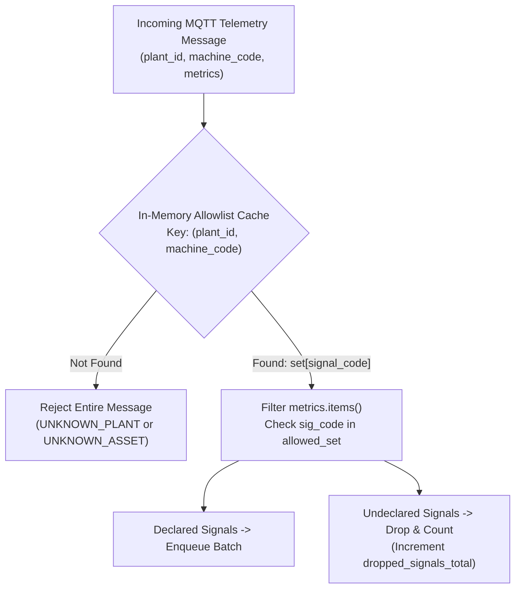

# Telemetry Ingest Signal Validation & Cardinality Defense

**Document:** `docs/design/ingest-signal-validation.md`  
**Status:** Plan / Ready for Implementation  
**Related Issue:** [Issue #102: Ingest accepts undeclared signals (cardinality and row-growth risk)](https://github.com/Shreekanth000001/Plant-Pulse/issues/102)  
**Branch:** `docs/plans-ingest-and-admin-token`  
**Target Delivery:** PR: `fix(ingest): fail-closed signal validation and message limits`  

---

## 1. Executive Summary & Root Cause Analysis

### 1.1 The Symptom & Live Stack Audit
A database audit of `telemetry_values` during test harness execution revealed **18 distinct undeclared machine/signal pairs** inserted across historical simulator cycles:
```sql
SELECT DISTINCT machine_code, signal_code 
FROM telemetry_values tv 
WHERE NOT EXISTS (
    SELECT 1 FROM signals s 
    WHERE s.plant_id = tv.plant_id 
      AND s.machine_code = tv.machine_code 
      AND s.signal_code = tv.signal_code
)
ORDER BY machine_code, signal_code;
```
**Affected Pairs (18 total):**
- `am_01`–`am_04`: `seal_pressure_setpoint`, `torque_setpoint`, `vibration` (12 pairs)
- `cs_01`–`cs_02`: `vibration`, `viscosity_setpoint` (4 pairs)
- `hm_01`–`hm_02`: `vibration` (2 pairs)

#### Live Stack Verification (Clean Production Behavior)
A 60-second live test was executed on the running Docker Compose stack with an active WebSocket viewer connected. A subsequent SQL query against PostgreSQL `telemetry_values` returned **0 undeclared rows**. In production, `main.py` passes `plants=plants_registry` to `IngestEngine`, enabling the machine signal filter and dropping undeclared metrics. The 18 undeclared rows observed earlier originated exclusively from standalone test/benchmark harnesses that instantiated `IngestEngine` without plant definitions.

### 1.2 Verified Root Cause
Investigation of `ingest.py`, `main.py`, and `demo/simulator/simulator.py` established how the defect manifested in harnesses and the inherent fail-open vulnerability:

1. **Constructor Parameter Binding:** In [`ingest.py#L217-L231`](file:///home/critic-coder/project/PlantPulse/ingest.py#L217-L231), the constructor signature is:
   ```python
   def __init__(
       self,
       db_path: Path | str | None = None,
       plants: dict[str, PlantDefinition] | None = None,
       plants_dir: Path | str | None = None,
       ...
   ) -> None:
       if plants is None and plants_dir is not None:
           self._plants = load_plants(Path(plants_dir))
       else:
           self._plants = plants or {}
   ```
   `db_path` is the **first positional argument**, while `plants` is second. In [`main.py#L796`](file:///home/critic-coder/project/PlantPulse/main.py#L796), `IngestEngine(plants=plants_registry)` passes `plants` as a keyword argument. However, test harnesses, benchmarks, and runner scripts called `IngestEngine(db.get_database_url())` positionally. Python bound the string URL to `db_path`, leaving `plants=None`. Consequently, `self._plants` resolved to an empty dictionary `{}`.

2. **Permissive Empty-Registry Bypass:** In [`ingest.py#L321-L338`](file:///home/critic-coder/project/PlantPulse/ingest.py#L321-L338):
   ```python
   valid_signal_codes: set[str] | None = None
   if self._plants:
       plant_def = self._plants.get(plant_id)
       if not plant_def:
           return False, "UNKNOWN_PLANT", []
       # ... loops over areas and machines ...
       valid_signal_codes = {s.signal_code for s in machine.signals}
   ```
   Because `{}` is falsy in Python, when `self._plants` was empty or uninitialized, the entire `if self._plants:` block was bypassed. The engine performed no plant check, no machine check, and left `valid_signal_codes = None`.

3. **Disabled Signal Filtering Guard:** In [`ingest.py#L376-L380`](file:///home/critic-coder/project/PlantPulse/ingest.py#L376-L380):
   ```python
   if topic_kind == "telemetry":
       metrics = payload_body.get("metrics") or {}
       for sig_code, val in metrics.items():
           if (
               valid_signal_codes is not None
               and sig_code not in valid_signal_codes
           ):
               continue
   ```
   Because `valid_signal_codes` was `None`, the guard `valid_signal_codes is not None` evaluated to `False`. The `continue` statement never executed, causing all metric keys in the incoming payload to be inserted into `telemetry_values`.

4. **Simulator Metric Emissions:** In [`demo/simulator/simulator.py#L245-L256`](file:///home/critic-coder/project/PlantPulse/demo/simulator/simulator.py#L245-L256) and [`demo/simulator/simulator.py#L561-L565`](file:///home/critic-coder/project/PlantPulse/demo/simulator/simulator.py#L561-L565), the machine simulation emits readings with both `vibration_mms` and `vibration`, plus setpoint metrics (`torque_setpoint`, `seal_pressure_setpoint`, `viscosity_setpoint`). These were not added to the simulator's internal `excluded` set, so they were broadcast as telemetry metrics.

5. **Lack of Database Foreign Key:** The PostgreSQL table `telemetry_values` has a composite primary key `(device_timestamp, plant_id, message_id, signal_code)` but no foreign key constraint referencing `signals(plant_id, machine_code, signal_code)`, allowing undeclared signals to be written directly into the partitions without database-level rejection.

### 1.3 Exact Shape of `valid_signal_codes`
The signal validation in `ingest.py` is **per-machine**, not per-plant and not a global union:
```python
for area in plant_def.areas:
    for machine in area.machines:
        if machine.machine_code == asset_id:
            machine_found = True
            valid_signal_codes = {s.signal_code for s in machine.signals}
            break
```
For `am_01` in `plant_demo_membrane`:
$$\text{valid\_signal\_codes} = \{\text{'seal\_pressure\_actual'}, \text{'torque\_actual'}, \text{'vibration\_mms'}\}$$
Signals like `vibration` (redundant) and `torque_setpoint` (not in `am_01` signals) are outside this machine's declared set.

### 1.4 Throwaway Reproduction Script & Verified Output
A reproduction script executed outside the repository confirmed the exact mechanism:
```python
# /tmp/repro_issue_102.py output:
=== Test 1: IngestEngine() with plants=None (default / positional db_path) ===
self._plants: {}
Envelope valid: True, Reason: OK
Extracted signals to insert: ['vibration_mms', 'vibration', 'torque_setpoint', 'torque_actual']

=== Test 2: IngestEngine(plants=plants) (with plant catalog) ===
self._plants count: 2
Envelope valid: True, Reason: OK
Extracted signals to insert: ['vibration_mms', 'torque_actual']
```
GitHub Issue #102 was updated via `gh issue edit 102` with this verified root cause.

---

## 2. Packet Size & Message Limits Audit

| System Boundary | Current Limit | Enforcement Location | Real Measured / Protocol Value | Vulnerability / Impact |
| :--- | :--- | :--- | :--- | :--- |
| **MQTT Broker (Mosquitto)** | Unset (`max_packet_size` missing) | [`docker/mosquitto.conf`](file:///home/critic-coder/project/PlantPulse/docker/mosquitto.conf) | 268,435,455 bytes (~256 MB) | Memory exhaustion; clients can transmit massive payloads to broker |
| **Admin REST API** | 1,048,576 bytes (1 MB) | `AdminBodyLimitMiddleware` ([`main.py#L864-L923`](file:///home/critic-coder/project/PlantPulse/main.py#L864-L923)) | 1 MB strict ASGI chunk counter | Protected against large admin payloads |
| **Ingest Payload Byte Limit** | None | [`ingest.py`](file:///home/critic-coder/project/PlantPulse/ingest.py) | Uncapped | Memory buffer risk if large JSON reaches topic handler |
| **Metrics Per Telemetry Message** | None | [`ingest.py#L374`](file:///home/critic-coder/project/PlantPulse/ingest.py#L374) | Uncapped (iterates all dict keys) | High-cardinality attack; 10,000 keys in `metrics` inserts 10,000 rows |
| **Signals Per Machine (Schema)** | 100 signals | `MAX_SIGNALS_PER_MACHINE` ([`plant_definitions.py#L18`](file:///home/critic-coder/project/PlantPulse/plant_definitions.py#L18)) | 100 | Enforced at plant definition validation |
| **Signals Per Plant (Schema)** | 500 signals | `MAX_SIGNALS_PER_PLANT` ([`plant_definitions.py#L19`](file:///home/critic-coder/project/PlantPulse/plant_definitions.py#L19)) | 500 | Enforced at plant registration / import |

### 2.1 Target Enforced Limits Specification

| Enforcement Layer | Parameter | Proposed Cap | Implementation Location | Failure Action |
| :--- | :--- | :--- | :--- | :--- |
| **MQTT Broker** | `max_packet_size` | 65,536 bytes (64 KB) | [`docker/mosquitto.conf`](file:///home/critic-coder/project/PlantPulse/docker/mosquitto.conf) | Broker drops packet / disconnects client exceeding 64 KB |
| **FastAPI Admin API** | Request Body Size | 1,048,576 bytes (1 MB) | `AdminBodyLimitMiddleware` ([`main.py`](file:///home/critic-coder/project/PlantPulse/main.py)) | HTTP 413 Payload Too Large (Stream aborted) |
| **Ingest Raw Payload** | `MAX_INGEST_PAYLOAD_BYTES` | 65,536 bytes (64 KB) | `IngestEngine.process_message()` ([`ingest.py`](file:///home/critic-coder/project/PlantPulse/ingest.py)) | Message discarded before JSON parse; log warning |
| **Ingest Envelope** | `MAX_METRICS_PER_ENVELOPE`| 100 metrics | `_validate_envelope()` ([`ingest.py`](file:///home/critic-coder/project/PlantPulse/ingest.py)) | Reject envelope (`TOO_MANY_METRICS`); 0 rows inserted |
| **Plant Catalog** | Machine Signal Cap | 100 signals | `MAX_SIGNALS_PER_MACHINE` ([`plant_definitions.py`](file:///home/critic-coder/project/PlantPulse/plant_definitions.py)) | Pydantic ValidationError (422 Unprocessable) |
| **Plant Catalog** | Plant Signal Cap | 500 signals | `MAX_SIGNALS_PER_PLANT` ([`plant_definitions.py`](file:///home/critic-coder/project/PlantPulse/plant_definitions.py)) | Pydantic ValidationError (422 Unprocessable) |

---

## 3. Architecture Options & Trade-offs

### 3.1 Allowlist Lookup Architecture



- **Option A1: Dynamic In-Memory Fast Lookup Cache (Recommended)**
  - Maintain `_machine_signals: dict[tuple[str, str], set[str]]` mapping `(plant_id, machine_code) -> set[signal_code]`.
  - Rebuilt in $O(N)$ on startup and updated in $O(1)$ whenever `update_plant()` or `remove_plant()` is called.
  - Telemetry validation lookup is $O(1)$ direct hash map lookup per message, avoiding nested iterations over areas and machines on every high-frequency tick.
- **Option A2: Nested Pydantic Traversal on Every Message (Current)**
  - Loops through `plant_def.areas` and `area.machines` for every incoming message.
  - Inefficient under multi-machine factory lines (e.g., 50 machines $\times$ 50 msgs/s = 2,500 traversals/s).

### 3.2 Filtering Policy: Reject Message vs Drop-and-Count

- **Option B1: Reject Entire Message (Fail-Closed at Message Level)**
  - If any metric key is unrecognized, reject the entire message (`is_valid = False`, reason `UNDECLARED_SIGNAL`).
  - *Trade-off:* Too aggressive. If a PLC firmware update adds a new diagnostic metric alongside 10 critical operational metrics, rejecting the whole packet blinds operators to real plant status and stops machine state tracking.
- **Option B2: Drop-and-Count Undeclared Signals (Recommended)**
  - Accept the message envelope; extract and persist only metrics whose `sig_code` exists in the machine's allowed set.
  - Count dropped metrics via an atomic counter `dropped_signals_total`.
  - Log a rate-limited warning (at most once every 10 seconds per plant/machine) naming the dropped signal keys.
  - If a message contains *only* undeclared metrics (and no status), discard the envelope.

### 3.3 Unknown Plant or Machine Behavior
- If `plant_id` is unknown in registry: Return `is_valid=False`, reason `UNKNOWN_PLANT`.
- If `machine_code` is unknown in plant: Return `is_valid=False`, reason `UNKNOWN_ASSET`.
- **Fail-Closed Guarantee:** If `self._plants` is empty or uninitialized, `IngestEngine` must **refuse to ingest** (return `is_valid=False`, reason `PLANT_REGISTRY_UNAVAILABLE`) rather than falling back to permissive bypass.

### 3.4 Simulator Extra Signals (18 Signals)
- In `demo/simulator/simulator.py`:
  - Machine simulation emits both `vibration_mms` (the official schema signal) and `vibration` (redundant legacy alias).
  - Simulator also emits `*_setpoint` keys for all machines.
  - **Resolution:**
    1. In `demo/simulator/simulator.py`, remove redundant `vibration` from `reading` (keep only `vibration_mms`).
    2. Add `_setpoint` keys to `plants/plant_demo_membrane.json` where setpoint tracking is desired, OR exclude them from simulator telemetry metrics to strictly match the declared catalog.

### 3.5 Existing 122 Historical Rows in PostgreSQL
- The 122 rows of undeclared signals in `telemetry_values` will be naturally dropped by the partition retention worker as partitions age past `RETENTION_DAYS`.
- An optional idempotent cleanup query can be added to database migration scripts:
  ```sql
  DELETE FROM telemetry_values tv
  WHERE NOT EXISTS (
      SELECT 1 FROM signals s
      WHERE s.plant_id = tv.plant_id
        AND s.machine_code = tv.machine_code
        AND s.signal_code = tv.signal_code
  );
  ```

### 3.6 Packet & Metric Size Safeguards
1. **Mosquitto Packet Cap (`max_packet_size`):**
   - In [`docker/mosquitto.conf`](file:///home/critic-coder/project/PlantPulse/docker/mosquitto.conf), `max_packet_size` is currently **unset**, leaving Mosquitto to accept messages up to the MQTT protocol maximum of 268,435,455 bytes (~256 MB).
   - **Fix:** Add `max_packet_size 65536` (64 KB). Normal telemetry envelopes are ~1–2 KB; 64 KB provides 30x headroom for batch metrics while preventing edge buffer exhaustion and memory exhaustion DoS attacks on the broker.
2. **Ingest Raw Payload Byte Cap (`MAX_INGEST_PAYLOAD_BYTES`):**
   - In `ingest.py`, enforce `MAX_INGEST_PAYLOAD_BYTES = 65536` (64 KB).
   - If an MQTT payload exceeds 64 KB, `IngestEngine.process_message()` drops the payload immediately prior to `json.loads()` deserialization, mitigating parser memory pressure even if the broker limit is misconfigured or bypassed.
3. **Metrics Count Cap (`MAX_METRICS_PER_ENVELOPE`):**
   - In `ingest.py`, enforce `MAX_METRICS_PER_ENVELOPE = 100`.
   - In `_validate_envelope()`, check `metrics = payload_body.get("metrics") or {}`. If `len(metrics) > MAX_METRICS_PER_ENVELOPE`, reject the entire envelope (`is_valid = False`, `reason = "TOO_MANY_METRICS"`).
   - Prevents high-cardinality row amplification attacks where an adversary sends thousands of dict keys in a single message to bloat `telemetry_values`.

---

## 4. Tests-First Specification

| Test Name | Target File | Pre-Implementation Failure Reason | Mutation Target |
| :--- | :--- | :--- | :--- |
| `test_ingest_drops_undeclared_signals_and_increments_counter` | `tests/test_ingest_signal_validation.py` | Undeclared signal `vibration` is inserted into `metric_rows` instead of being dropped. | Remove signal allowlist check in `ingest.py`. |
| `test_ingest_fails_closed_when_plants_registry_empty` | `tests/test_ingest_signal_validation.py` | `IngestEngine()` accepts message with `reason="OK"` when `plants` is `None` or `{}`. | Remove `if not self._plants: return False, "PLANT_REGISTRY_UNAVAILABLE"` guard. |
| `test_ingest_rejects_payload_exceeding_metric_count_cap` | `tests/test_ingest_signal_validation.py` | Envelopes with 101 metrics are accepted without error. | Remove `len(metrics) > MAX_METRICS_PER_ENVELOPE` check. |
| `test_ingest_preserves_valid_metrics_when_one_metric_is_undeclared` | `tests/test_ingest_signal_validation.py` | Fails if entire message is rejected instead of filtering only the undeclared key. | Change drop-and-count logic to reject entire envelope. |
| `test_simulator_emits_only_declared_plant_signals` | `tests/test_demo_simulator.py` | Simulator `tick()` contains `vibration` key not declared in `plant_demo_membrane.json`. | Re-introduce `'vibration'` in `simulator.py` tick dict. |
| `test_mosquitto_conf_declares_max_packet_size` | `tests/test_broker_config.py` | `docker/mosquitto.conf` lacks `max_packet_size` directive. | Delete `max_packet_size` line in `docker/mosquitto.conf`. |

---

## 5. Implementation PR Split & Rollback Plan

### PR Split
- **PR 1: `fix(ingest): fail-closed signal validation and machine allowlist cache`**
  - Update `IngestEngine`: enforce fail-closed when registry is empty; build O(1) `(plant_id, machine_code) -> set[signal_code]` lookup cache.
  - Implement drop-and-count filtering with `dropped_signals_total` metric.
  - Add metric count cap (`MAX_METRICS_PER_ENVELOPE = 100`).
  - Unit and integration tests in `tests/test_ingest_signal_validation.py`.
- **PR 2: `fix(simulator): align simulator telemetry keys with plant catalog and cap broker packet size`**
  - Remove legacy `vibration` emission from `demo/simulator/simulator.py`.
  - Add `max_packet_size 65536` to `docker/mosquitto.conf`.
  - Clean up existing undeclared rows in test database.

### Rollback Strategy
If signal validation inadvertently drops valid device telemetry in production:
1. Revert PR 1 commit via `git revert`.
2. Telemetry ingestion immediately returns to previous behavior where all metric keys are written to PostgreSQL.
3. No database schema migration or rollback is required because `telemetry_values` columns and partitions remain identical.

---

## 6. Open Questions
1. **Dynamic Foreign Key Constraint:** Should PostgreSQL add an explicit foreign key `FOREIGN KEY (plant_id, machine_code, signal_code) REFERENCES signals(plant_id, machine_code, signal_code)`?  
   *Assessment:* PostgreSQL allows foreign keys on partitioned tables referencing regular tables in PostgreSQL 16. However, it requires an index on the referenced columns and adds per-insert FK validation overhead. Given the ingest queue does batch writes of 100 rows, in-memory validation in `IngestEngine` is much higher performance ($O(1)$ Python set lookup vs PostgreSQL FK lock).
2. **Alerting on Dropped Signals:** Should dropped signals trigger a platform alarm event visible in the UI header?  
   *Assessment:* Yes, a new alarm type `UNKNOWN_SIGNAL_DETECTED` can notify operators when a PLC is transmitting unmapped data.
