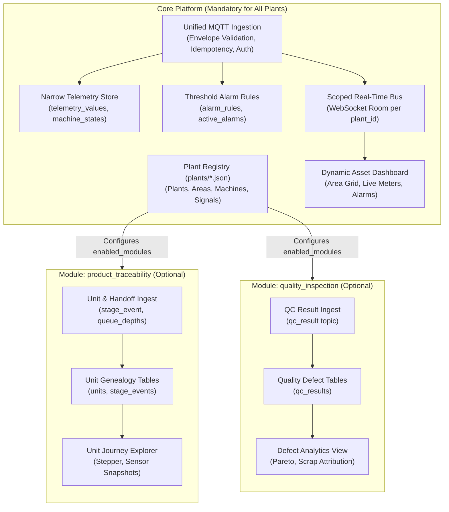
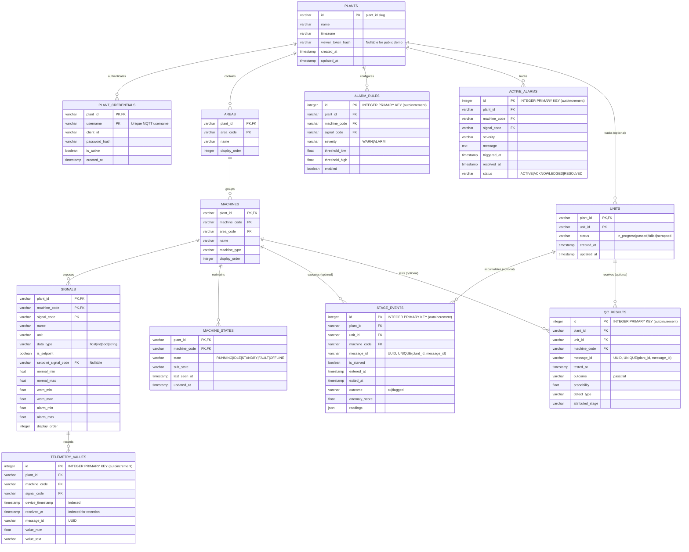
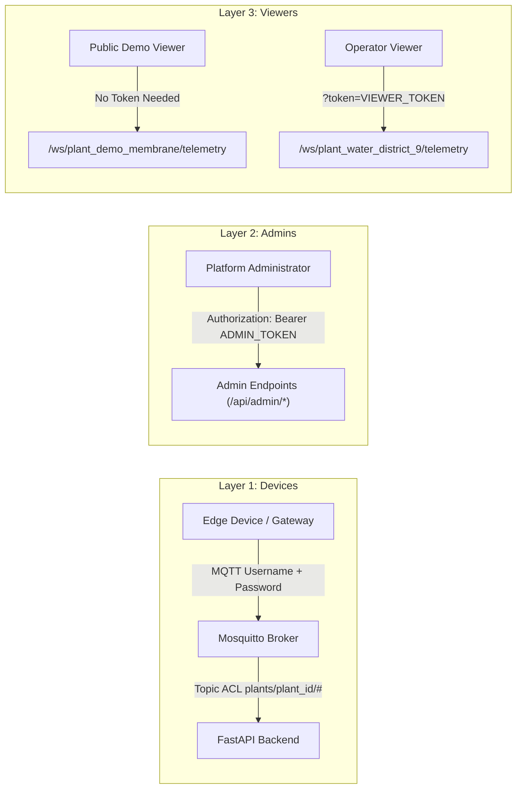
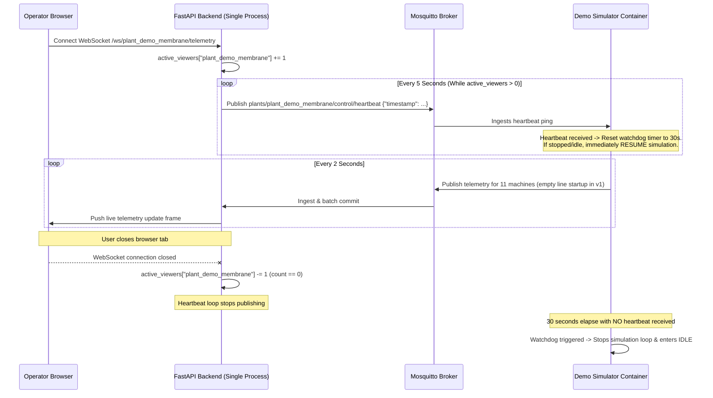
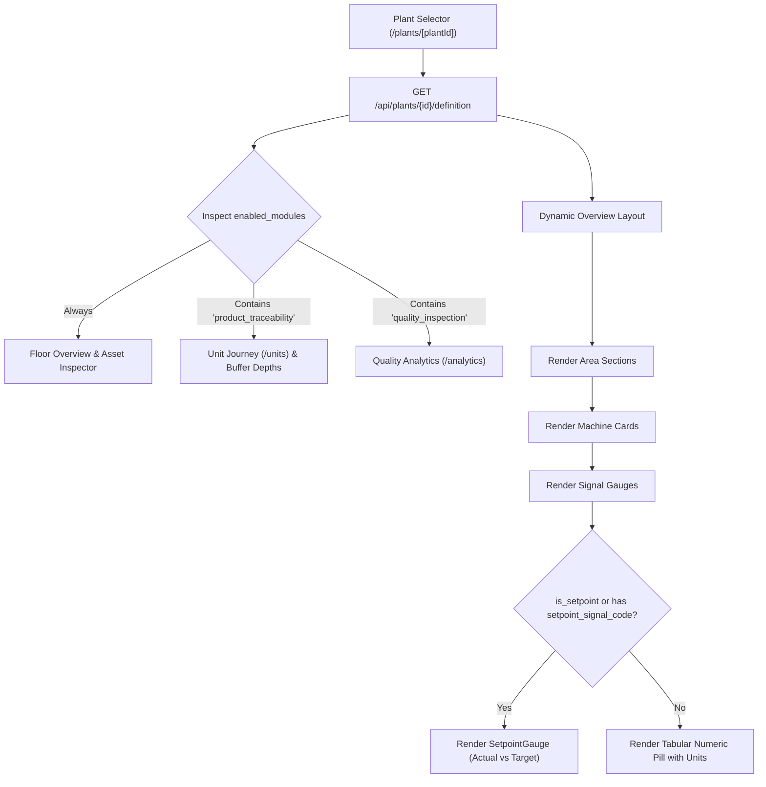
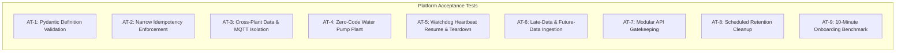

# PlantPulse Multi-Plant Telemetry Platform — Architecture & System Design

**Document Version:** 2.0.0  
**Status:** DRAFT (Revised per Design Review)  
**Target Environment:** Single always-on Linux VM running Docker Compose (Mosquitto, FastAPI, Next.js, SQLite/PostgreSQL)  
**Acceptance Goal:** A new plant operator connects their own MQTT telemetry stream and visualizes live data on screen in under 10 minutes.

---

## Changes in this Version (v2.0.0 Changelog)

| Requirement / Defect ID | Summary of Change | Affected Section(s) in this Document |
| :--- | :--- | :--- |
| **Decision 1 / Defect A** | Specified three-tier authentication: (a) Devices: per-plant MQTT credentials + Mosquitto topic ACLs; (b) Admins: single admin token required on admin/maintenance endpoints; (c) Viewers: per-plant read token; public demo plant is read-only. Designed WebSocket browser authentication using query parameter token validation. Clarified that public deployments mount NO admin endpoints and keep MQTT internal. | Section 4.6, Section 4.7, Section 7.1, Section 8 (AT-3), Section 10.1 (Decision 1) |
| **Decision 2 / Defect D** | Replaced 10-minute clock-skew rejection with late-data policy: accept messages up to `MAX_LATE_SECONDS` old (default 6 hours, configurable) stored by `device_timestamp`; reject messages > 5 minutes in future. Scheduled daily retention cleanup for rows > $N$ days. Time-based partitioning marked Planned (PostgreSQL). | Concerns (Concern 3), Section 4.4, Section 8 (AT-6), Section 9 (PR 8), Section 10.1 (Decision 3), Section 11 |
| **Decision 3 / Defect B, C, G** | Redesigned metrics storage as narrow rows in `telemetry_values(plant_id, machine_code, signal_code, device_timestamp, received_at, message_id, value_num, value_text)`. Enforced idempotency via `UNIQUE(plant_id, message_id, signal_code)` with insert-or-ignore. Separated machine state into `machine_states`. Added concrete daily row volume calculations for both example plants. | Section 3.1, Section 3.2, Section 3.3, Section 4.5, Section 10.1 (Decision 2) |
| **Decision 4 / Defect E, F** | Switched plant provisioning from dynamic API to file-based JSON definitions in `plants/` directory, validated at startup via Pydantic model. Added script `scripts/generate_mosquitto_auth.py` to generate Mosquitto password and ACL files with rotation instructions. Registration API moved to Planned. | Section 4.6, Section 5.1, Section 5.4, Section 8 (AT-1), Section 9 (PR 1), Section 10.1 (Decision 4), Section 11 |
| **Decision 5 / Defect H, M** | Deferred demo simulator warm-up to Planned (requires simulated clock). v1 starts simulator from an empty line. Removed AT-5. Changed watchdog protocol: heartbeat itself means "run" (resumes restarted simulator without separate START command). Corrected rationale: stopping simulator saves disk data growth, not CPU. | Concerns (Concern 2), Section 6.1, Section 6.2, Section 8 (AT-5), Section 10.1 (Decision 6), Section 11 |
| **Defect B** | Replaced concatenated string keys with true composite primary and foreign keys `(plant_id, ...)`. Added composite foreign keys linking `stage_events` and `qc_results` to `units(plant_id, unit_id)` and `machines(plant_id, machine_code)`. | Section 3.1, Section 3.2, Section 10.1 (Decision 7) |
| **Defect C** | Added `message_id` to `stage_events` and `qc_results` with `UNIQUE(plant_id, message_id)` constraints and insert-or-ignore. Removed reliance on an in-memory idempotency cache. | Section 3.2, Section 4.2, Section 4.5, Section 8 (AT-2) |
| **Defect E** | Reconciled signal codes across JSON definitions, DDL, and message examples (e.g. `mold_temperature_actual`, `mold_temperature_setpoint`). Added `alarm_min`, `alarm_max`, and `setpoint_signal_code` to schema and verified references. Provided complete Pydantic model for plant definitions and automated validation test. | Section 3.2, Section 4.3, Section 5.1, Section 5.2, Section 5.3, Section 8 (AT-1) |
| **Defect F** | Documented Mosquitto credential creation and secret rotation procedure using `scripts/generate_mosquitto_auth.py` and `kill -HUP` reload. | Section 4.6 |
| **Defect G** | Used `INTEGER PRIMARY KEY` for SQLite autoincrement ROWID. Renamed reserved SQL keyword column `values` to `value_num` and `value_text`. Corrected Concern 1: single synchronous writer does not cause "database is locked"; the actual bottlenecks are event-loop blocking and per-message fsync overhead. | Concerns (Concern 1), Section 3.2 |
| **Defect I** | Moved `is_starved` and unit counters (`units_produced`, `units_rejected`) out of the core envelope into optional `product_traceability`. Added `STANDBY` machine state (`RUNNING`, `IDLE`, `STANDBY`, `FAULT`, `OFFLINE`). | Section 4.2, Section 4.3 |
| **Defect J** | Explicitly stated assumption of ONE API process (single Uvicorn worker) and documented reasons (in-memory viewer counts, batching queue, SQLite single-writer coordination). | Section 2.1, Section 6.2, Section 10.1 (Decision 5) |
| **Defect K** | Deleted old migrations 0003 and 0004. Simulated legacy database will be discarded; v1 starts from a clean baseline migration `0001_initial_schema.py`. | Section 3.4 |
| **Defect L** | Replaced all file links with clean relative paths. Removed Prometheus references. Replaced unowned `$schema` URL with standard URN `urn:plantpulse:schema:v1:envelope`. | Files Reviewed, Section 4.2, Section 4.4 |
| **Defect M** | Reordered delivery plan as a walking skeleton (PR 1–9), split slices exceeding 300 changed lines, added slices for retention and rate limits, and reset Gantt chart statuses to planned. | Section 9 |
| **Defect N** | Restructured Section 10 into "10.1 Decisions made (this document)" and "10.2 Decisions still open". | Section 10.1, Section 10.2 |

---

## Files Reviewed Prior to Design

The following files from the PlantPulse repository were audited to construct this design:
- [`config.py`](config.py): Hardcoded facility topology (`FACILITY`), 4 stages, 11 machines, setpoints, cycle times.
- [`simulator.py`](simulator.py): `MachineSim`, `QCStation`, and `Line` queue wiring for the membrane manufacturing process.
- [`units.py`](units.py): Traceable `Unit` object carrying in-memory journey history and anomaly scores.
- [`defect_model.py`](defect_model.py): QC defect probability calculations (shift handoffs, weather placeholder, anomaly bias).
- [`mqtt_publisher.py`](mqtt_publisher.py): Background process publishing simulation data to `factory/#` topics.
- [`database.py`](database.py): SQLAlchemy models (`TelemetryReading`, `Unit`, `StageEvent`, `QCResult`) and SQLite engine configuration.
- [`main.py`](main.py): FastAPI backend, MQTT subscriber (`aiomqtt`), WebSocket connection manager, and REST endpoints.
- [`tests/test_defect_model.py`](tests/test_defect_model.py): Tests for defect probability calculation and shift bias.
- [`tests/test_simulator.py`](tests/test_simulator.py): Cycle time verification tests across membrane machines.
- [`README.md`](README.md): System overview, architecture diagram, design decisions, and limitations.
- [`.github/workflows/ci.yml`](.github/workflows/ci.yml): GitHub Actions CI pipelines for backend lint/smoke/tests and frontend lint/build.
- `frontend/`: Audited `types/factory.ts`, `lib/api.ts`, `context/WebSocketContext.tsx`, `app/layout.tsx`, `app/page.tsx`, `app/units/page.tsx`, `app/units/[unitId]/page.tsx`, `app/analytics/page.tsx`, `components/layout/AppShell.tsx`, `components/layout/Sidebar.tsx`, `components/layout/Header.tsx`, `components/telemetry/ProductionFlowTopology.tsx`, `components/telemetry/MachineCard.tsx`, `components/telemetry/OEEHeader.tsx`, `components/telemetry/QueueHandoffIndicator.tsx`, `components/telemetry/ReadingsGrid.tsx`, `components/telemetry/SetpointGauge.tsx`, `components/telemetry/StationInspectorModal.tsx`, `components/telemetry/LiveEventTicker.tsx`, `components/notifications/QCAlertToast.tsx`.

---

## Architectural Concerns & Mitigations

> [!WARNING]
> ### Concern 1: Event-Loop Blocking & fsync Bottlenecks Under SQLite Ingestion
> **The Problem:** In a single-process FastAPI application with SQLite, a single synchronous writer does *not* produce `database is locked` errors. Instead, the true performance killers are:
> 1. **Event-Loop Blocking:** Executing synchronous SQLite file I/O directly inside async MQTT callbacks blocks the asyncio event loop, preventing timely WebSocket broadcasts and incoming network socket reads.
> 2. **Per-Message fsync Overhead:** Issuing a disk commit (`fsync`) for every incoming MQTT message restricts write throughput to disk I/O limits (~50–100 commits/second on standard SSDs), which will choke when multiple machines publish telemetry every 1–2 seconds.  
> **Mitigation:**
> 1. SQLite is configured with Write-Ahead Logging (`PRAGMA journal_mode=WAL;`) and synchronous normal (`PRAGMA synchronous=NORMAL;`).
> 2. Implement an in-memory queue (`asyncio.Queue`) in FastAPI. Telemetry readings are enqueued non-blockingly by the MQTT handler. A dedicated background worker pulls chunks from the queue and commits them in bulk transactions every 500ms or 100 items inside `asyncio.to_thread()`, keeping disk I/O off the async event loop and amortizing fsync overhead.
> 3. Portability via `DATABASE_URL`: Moving to PostgreSQL requires zero application code changes when write volumes grow.

> [!WARNING]
> ### Concern 2: Simulator Disk Storage Exhaustion on Resource-Constrained Host
> **The Problem:** The demo simulator produces continuous high-frequency telemetry. Running it 24/7 on a single small VM does not primarily stress the CPU, but it rapidly exhausts disk space with unneeded synthetic telemetry rows (over 1.3 million rows / ~447 MB per day (339 bytes per row, measured in bench/sqlite_bench.py)).  
> **Mitigation:** The simulator operates strictly on-demand. FastAPI emits heartbeat messages (`plants/{plant_id}/control/heartbeat`) every 5 seconds only while active WebSocket viewers are connected to the demo plant. The simulator shuts down its publishing loop when no heartbeats are received for 30 seconds.

> [!NOTE]
> ### Concern 3: Edge Gateway Disconnections & Store-and-Forward Replay
> **The Problem:** Industrial gateways frequently lose cellular or WAN connectivity. If gateways buffer messages locally and upload them in batches upon reconnection (store-and-forward), an aggressive 10-minute clock-skew rejection policy would drop all valid historical data.  
> **Mitigation:** Implement a configurable late-data window (`MAX_LATE_SECONDS`, default 6 hours / 21,600s). Ingestion accepts readings timestamped up to 6 hours in the past and indexes them by `device_timestamp`. Readings timestamped more than 5 minutes into the future (`device_timestamp > server_now + 300s`) are rejected as clock-misconfigured.

> [!NOTE]
> ### Concern 4: Dynamic UI Layout Instability at High Telemetry Tick Rates
> **The Problem:** When UI widgets and signal meters are dynamically derived from JSON metadata rather than static TypeScript structs, 1–2s tick updates can trigger re-layout calculations, high client CPU usage, and visual shifting.  
> **Mitigation:** Enforce deterministic signal ordering using `display_order`, memoize widget lookups (`useMemo`), isolate dynamic metric updates into localized state leaves, and use monospace tabular numeric figures (`tabular-nums`) to prevent layout shifts.

---

## 1. Current-State Audit: Hardcoded vs. Generic

The current codebase is tightly coupled to a single 8040 spiral-wound membrane manufacturing facility. The following audit details every hardcoded element across the backend and frontend:

| Component / File | Symbol / Function | Current Implementation | Classification | Platform Migration Requirement |
| :--- | :--- | :--- | :--- | :--- |
| [`config.py`](config.py) | `FACILITY` | Hardcoded dict with `facility_id: "fac_1"`, 4 fixed sub-facilities (`sf_housing`, `sf_casting`, `sf_assembly`, `sf_qc`). | **Hardcoded** | Replace with file-based JSON definitions in `plants/` defining arbitrary areas and machines. |
| [`config.py`](config.py) | `make_housing_machine`, etc. | Hardcoded sensor setpoints (`mold_temperature_setpoint: 65.0`), std deviations, vibration baselines. | **Hardcoded** | Move signal definitions, units, setpoints, and warning/alarm thresholds into plant definition JSON files. |
| [`config.py`](config.py) | `HOUSING_PHASES`, `HOUSING_FAULT_CODES` | Hardcoded stage phase lists and fault string lists. | **Hardcoded** | Machines report dynamic status and sub-status strings. Specific stage names removed from core platform. |
| [`simulator.py`](simulator.py) | `MachineSim` | Generic reading extraction via `_extract_readings`, but assumes membrane phases and unit handoff queues. | **Partially Generic** | Decouple from platform. Move simulator to external client directory (`demo/simulator/`). |
| [`simulator.py`](simulator.py) | `QCStation`, `Line` | Hardcoded 4-stage sequential pipeline (`STAGE_ORDER = ["housing", "casting", "assembly", "qc"]`). | **Hardcoded** | Simulator-specific orchestration. Platform core must never assume sequential queue-linked stages. |
| [`units.py`](units.py) | `Unit` | In-memory unit tracking with membrane-specific history fields (`anomaly_score`, `sub_facility`). | **Hardcoded** | Move into optional `product_traceability` module. |
| [`defect_model.py`](defect_model.py) | `compute_defect_probability` | Mathematical defect model with hardcoded shift hours (`{6, 14, 22}`) and anomaly weights. | **Hardcoded** | Externalize into demo simulator client. Platform stores and reports data; it does not model defects. |
| [`mqtt_publisher.py`](mqtt_publisher.py) | `publish_reading` | Topics: `factory/{sub}/{machine}/telemetry`, `factory/{sub}/{machine}/stage_event`, `factory/qc/.../result`, `factory/queue_depths`. | **Hardcoded** | Replace with standard envelope publishing to `plants/{plant_id}/assets/{machine_code}/telemetry`. |
| [`database.py`](database.py) | `TelemetryReading` | Fixed columns: `sub_facility`, `phase`, `starved`, `current_unit_id`, `vibration`, `vibration_wear_level`, `good_count`, `reject_count`, `extra`. | **Hardcoded Schema** | Replace with narrow `telemetry_values` table storing `(plant_id, machine_code, signal_code, value_num, value_text)`. |
| [`database.py`](database.py) | `Unit`, `StageEvent`, `QCResult` | Mandatory tables modeling unit genealogy and membrane QC verdicts. Missing `plant_id`. | **Hardcoded Domain** | Isolate into optional modules. Add `plant_id` composite keys and foreign keys. |
| [`main.py`](main.py) | `MQTT_TOPIC = "factory/#"` | Subscribes to single hardcoded topic prefix. | **Hardcoded** | Subscribe to `plants/+/assets/+/telemetry` and modular sub-topics with dynamic topic routing. |
| [`main.py`](main.py) | `handle_message` | Parses topics with 4 parts assuming `factory/{sub_facility}/{machine_id}/{kind}`. | **Hardcoded** | Implement dynamic topic router matching `plants/{plant_id}/...`. |
| [`main.py`](main.py) | `latest_queue_depths` | Global in-memory dictionary for membrane stage queues. | **Hardcoded** | Move to module-scoped cache: `dict[plant_id, dict[str, int]]`. |
| [`main.py`](main.py) | `/api/machines/latest`, etc. | Queries return rows without any plant scoping or tenant isolation. | **Single-Tenant** | Scope every REST and WebSocket query by `plant_id`. Return 404 for non-existent plants. |
| [`main.py`](main.py) | `/ws/telemetry` | Broadcasts all messages to every connected WebSocket client without filtering. | **Single-Tenant** | Parameterize as `/ws/{plant_id}/telemetry` with room-based broadcast isolation and viewer auth token check. |
| [`frontend/types/factory.ts`](frontend/types/factory.ts) | `KNOWN_MACHINES`, `SubFacilityType` | Hardcoded map of 11 membrane machines (`hm_01`–`qc_01`) and fixed stage unions (`housing`, `casting`, etc.). | **Hardcoded** | Replace with dynamic plant definition types fetched from `/api/plants/{plant_id}/definition`. |
| [`frontend/components/telemetry/ProductionFlowTopology.tsx`](frontend/components/telemetry/ProductionFlowTopology.tsx) | `FLOW_STAGES` | Hardcoded visual topology with 4 stages and cycle times (75s, 120s, 50s, 20s). | **Hardcoded** | Dynamic process flow rendered only when `product_traceability` is enabled; otherwise renders an Area Zone Grid. |
| [`frontend/components/telemetry/OEEHeader.tsx`](frontend/components/telemetry/OEEHeader.tsx) | OEE calculation | Hardcoded 8-hour shift rhythm and heuristic calculations tailored to membrane machinery. | **Hardcoded** | Dynamic metric cards based on plant signals and active module flags. |
| [`frontend/app/page.tsx`](frontend/app/page.tsx) | Live Overview | Hardcoded `STAGES` constant defining Housing, Casting, Assembly, QC. | **Hardcoded** | Fetch plant definition on mount; dynamically group machines by area. |
| [`frontend/app/units/`](frontend/app/units/) | Unit Genealogy | Dedicated route assuming every plant tracks serial numbers, stage events, and QC verdicts. | **Hardcoded** | Make route conditional; hide navigation when `product_traceability` module is disabled. |

---

## 2. Core Platform vs. Optional Modules

### 2.1 Single API Process Assumption
> [!IMPORTANT]
> **Single API Process Guarantee:** The platform v1 architecture explicitly assumes execution within **ONE API process** (a single Uvicorn worker).
> 
> **Rationale:**
> 1. **In-Memory Active Viewer State:** Tracking the number of active WebSocket viewers per plant (`active_viewers[plant_id]`) to drive the demo simulator watchdog heartbeat requires no distributed locks or Redis synchronization.
> 2. **Ingestion Batch Buffer:** The `asyncio.Queue` batching worker aggregates telemetry commits to SQLite within a single process memory space.
> 3. **SQLite Single-Writer Concurrency:** A single Python process managing SQLite write transactions prevents database lock contention.
> 4. If horizontal scaling across multiple API processes is required in the future, shared state (viewer counts, batch queues, rate limits) must be externalized to Redis, and SQLite must be upgraded to PostgreSQL.

### 2.2 Architecture Diagram



### 2.3 Module Boundaries and Behaviors

1. **Core Platform (Always Present)**:
   - **Plant & Asset Hierarchy**: Plants $\to$ Areas $\to$ Machines $\to$ Signals.
   - **Ingestion & Validation**: Validates all MQTT payloads against the canonical JSON envelope, enforces the late-data window, checks idempotency via unique database constraints, and updates machine states.
   - **Machine State Tracking**: Tracks operating states: `RUNNING`, `IDLE`, `STANDBY`, `FAULT`, `OFFLINE`.
   - **Narrow Telemetry Store**: Records one row per `(plant_id, message_id, signal_code)` in `telemetry_values`.
   - **Alarm Engine**: Compares numeric readings against warning and critical thresholds in `alarm_rules`, maintaining `active_alarms`.
   - **Dynamic SCADA UI**: Renders any plant layout dynamically from its registered JSON definition.

2. **Optional Module: `product_traceability`**:
   - Activated only when `enabled_modules` in the plant definition contains `"product_traceability"`.
   - Ingests unit lifecycles, stage events, machine starved states, and WIP buffer counts (`stage_event`, `queue_depths`).
   - Powers the Unit Lookup and Serial Timeline view.
   - *Behavior when disabled:* API returns `404 Not Found` for `/api/plants/{plant_id}/units/*`, and the UI hides all serialization navigation links and buffer indicators.

3. **Optional Module: `quality_inspection`**:
   - Activated only when `enabled_modules` contains `"quality_inspection"`.
   - Ingests test station results, pass/fail outcomes, defect codes, and stage attribution (`qc_result`).
   - Powers the Quality Analytics and Defect Pareto views.
   - *Behavior when disabled:* API returns `404 Not Found` for `/api/plants/{plant_id}/qc/*`, and defect toasts/charts are suppressed.

---

## 3. Data Model & Database Architecture

### 3.1 Entity-Relationship Diagram (Composite Keys)

All child entities utilize true composite primary and foreign keys starting with `plant_id`. A record in Plant A can never reference an area, machine, signal, or unit belonging to Plant B.



### 3.2 SQL Table Definitions (DDL)

```sql
-- 1. Core Platform: Plants
CREATE TABLE plants (
    id VARCHAR(64) PRIMARY KEY,
    name VARCHAR(255) NOT NULL,
    timezone VARCHAR(64) NOT NULL DEFAULT 'UTC',
    viewer_token_hash VARCHAR(255) NULL, -- NULL = public read-only demo plant
    created_at TIMESTAMP WITH TIME ZONE NOT NULL DEFAULT CURRENT_TIMESTAMP,
    updated_at TIMESTAMP WITH TIME ZONE NOT NULL DEFAULT CURRENT_TIMESTAMP
);

-- 2. Core Platform: MQTT Device Credentials
CREATE TABLE plant_credentials (
    plant_id VARCHAR(64) NOT NULL REFERENCES plants(id) ON DELETE CASCADE,
    username VARCHAR(128) NOT NULL,
    client_id VARCHAR(128) NOT NULL,
    password_hash VARCHAR(255) NOT NULL,
    is_active BOOLEAN NOT NULL DEFAULT TRUE,
    created_at TIMESTAMP WITH TIME ZONE NOT NULL DEFAULT CURRENT_TIMESTAMP,
    PRIMARY KEY (plant_id, username)
);
CREATE INDEX idx_credentials_username ON plant_credentials(username);

-- 3. Core Platform: Areas
CREATE TABLE areas (
    plant_id VARCHAR(64) NOT NULL REFERENCES plants(id) ON DELETE CASCADE,
    area_code VARCHAR(64) NOT NULL,
    name VARCHAR(255) NOT NULL,
    display_order INTEGER NOT NULL DEFAULT 0,
    PRIMARY KEY (plant_id, area_code)
);
CREATE INDEX idx_areas_order ON areas(plant_id, display_order);

-- 4. Core Platform: Machines
CREATE TABLE machines (
    plant_id VARCHAR(64) NOT NULL REFERENCES plants(id) ON DELETE CASCADE,
    machine_code VARCHAR(64) NOT NULL,
    area_code VARCHAR(64) NOT NULL,
    name VARCHAR(255) NOT NULL,
    machine_type VARCHAR(64) NOT NULL DEFAULT 'standard',
    display_order INTEGER NOT NULL DEFAULT 0,
    PRIMARY KEY (plant_id, machine_code),
    FOREIGN KEY (plant_id, area_code) REFERENCES areas(plant_id, area_code) ON DELETE CASCADE
);
CREATE INDEX idx_machines_area ON machines(plant_id, area_code);

-- 5. Core Platform: Signals Catalog
CREATE TABLE signals (
    plant_id VARCHAR(64) NOT NULL REFERENCES plants(id) ON DELETE CASCADE,
    machine_code VARCHAR(64) NOT NULL,
    signal_code VARCHAR(64) NOT NULL,
    name VARCHAR(255) NOT NULL,
    unit VARCHAR(32) NOT NULL DEFAULT '',
    data_type VARCHAR(32) NOT NULL DEFAULT 'float', -- float, int, bool, string
    is_setpoint BOOLEAN NOT NULL DEFAULT FALSE,
    setpoint_signal_code VARCHAR(64) NULL,
    normal_min FLOAT NULL,
    normal_max FLOAT NULL,
    warn_min FLOAT NULL,
    warn_max FLOAT NULL,
    alarm_min FLOAT NULL,
    alarm_max FLOAT NULL,
    display_order INTEGER NOT NULL DEFAULT 0,
    PRIMARY KEY (plant_id, machine_code, signal_code),
    FOREIGN KEY (plant_id, machine_code) REFERENCES machines(plant_id, machine_code) ON DELETE CASCADE,
    FOREIGN KEY (plant_id, machine_code, setpoint_signal_code) 
        REFERENCES signals(plant_id, machine_code, signal_code) ON DELETE SET NULL
);
CREATE INDEX idx_signals_order ON signals(plant_id, machine_code, display_order);

-- 6. Core Platform: Machine Live State
CREATE TABLE machine_states (
    plant_id VARCHAR(64) NOT NULL REFERENCES plants(id) ON DELETE CASCADE,
    machine_code VARCHAR(64) NOT NULL,
    state VARCHAR(32) NOT NULL DEFAULT 'IDLE', -- RUNNING, IDLE, STANDBY, FAULT, OFFLINE
    sub_state VARCHAR(64) NULL,
    last_seen_at TIMESTAMP WITH TIME ZONE NOT NULL,
    updated_at TIMESTAMP WITH TIME ZONE NOT NULL,
    PRIMARY KEY (plant_id, machine_code),
    FOREIGN KEY (plant_id, machine_code) REFERENCES machines(plant_id, machine_code) ON DELETE CASCADE
);

-- 7. Core Platform: Narrow Telemetry Values (High Volume)
-- In SQLite, INTEGER PRIMARY KEY provides 64-bit signed autoincrement ROWID.
CREATE TABLE telemetry_values (
    id INTEGER PRIMARY KEY,
    plant_id VARCHAR(64) NOT NULL REFERENCES plants(id) ON DELETE CASCADE,
    machine_code VARCHAR(64) NOT NULL,
    signal_code VARCHAR(64) NOT NULL,
    device_timestamp TIMESTAMP WITH TIME ZONE NOT NULL,
    received_at TIMESTAMP WITH TIME ZONE NOT NULL DEFAULT CURRENT_TIMESTAMP,
    message_id VARCHAR(64) NOT NULL,
    value_num FLOAT NULL,
    value_text VARCHAR(255) NULL,
    FOREIGN KEY (plant_id, machine_code, signal_code) 
        REFERENCES signals(plant_id, machine_code, signal_code) ON DELETE CASCADE,
    CONSTRAINT uq_telemetry_idempotency UNIQUE (plant_id, message_id, signal_code)
);
CREATE INDEX idx_telemetry_series ON telemetry_values(plant_id, machine_code, signal_code, device_timestamp DESC);
CREATE INDEX idx_telemetry_retention ON telemetry_values(received_at);

-- 8. Core Platform: Alarm Rules
CREATE TABLE alarm_rules (
    id INTEGER PRIMARY KEY,
    plant_id VARCHAR(64) NOT NULL REFERENCES plants(id) ON DELETE CASCADE,
    machine_code VARCHAR(64) NOT NULL,
    signal_code VARCHAR(64) NOT NULL,
    severity VARCHAR(32) NOT NULL, -- WARN, ALARM
    threshold_low FLOAT NULL,
    threshold_high FLOAT NULL,
    enabled BOOLEAN NOT NULL DEFAULT TRUE,
    FOREIGN KEY (plant_id, machine_code, signal_code) 
        REFERENCES signals(plant_id, machine_code, signal_code) ON DELETE CASCADE
);
CREATE INDEX idx_alarm_rules_signal ON alarm_rules(plant_id, machine_code, signal_code);

-- 9. Core Platform: Active Alarms
CREATE TABLE active_alarms (
    id INTEGER PRIMARY KEY,
    plant_id VARCHAR(64) NOT NULL REFERENCES plants(id) ON DELETE CASCADE,
    machine_code VARCHAR(64) NOT NULL,
    signal_code VARCHAR(64) NOT NULL,
    severity VARCHAR(32) NOT NULL, -- WARN, ALARM
    message TEXT NOT NULL,
    triggered_at TIMESTAMP WITH TIME ZONE NOT NULL,
    resolved_at TIMESTAMP WITH TIME ZONE NULL,
    status VARCHAR(32) NOT NULL DEFAULT 'ACTIVE', -- ACTIVE, ACKNOWLEDGED, RESOLVED
    FOREIGN KEY (plant_id, machine_code, signal_code) 
        REFERENCES signals(plant_id, machine_code, signal_code) ON DELETE CASCADE
);
CREATE INDEX idx_active_alarms_plant ON active_alarms(plant_id, status);

-- 10. Optional Module: Units (product_traceability)
CREATE TABLE units (
    plant_id VARCHAR(64) NOT NULL REFERENCES plants(id) ON DELETE CASCADE,
    unit_id VARCHAR(128) NOT NULL,
    status VARCHAR(32) NOT NULL DEFAULT 'in_progress',
    created_at TIMESTAMP WITH TIME ZONE NOT NULL DEFAULT CURRENT_TIMESTAMP,
    updated_at TIMESTAMP WITH TIME ZONE NOT NULL DEFAULT CURRENT_TIMESTAMP,
    PRIMARY KEY (plant_id, unit_id)
);
CREATE INDEX idx_units_created ON units(plant_id, created_at DESC);

-- 11. Optional Module: Stage Events (product_traceability)
CREATE TABLE stage_events (
    id INTEGER PRIMARY KEY,
    plant_id VARCHAR(64) NOT NULL REFERENCES plants(id) ON DELETE CASCADE,
    unit_id VARCHAR(128) NOT NULL,
    machine_code VARCHAR(64) NOT NULL,
    message_id VARCHAR(64) NOT NULL,
    is_starved BOOLEAN NOT NULL DEFAULT FALSE,
    entered_at TIMESTAMP WITH TIME ZONE NULL,
    exited_at TIMESTAMP WITH TIME ZONE NULL,
    outcome VARCHAR(32) NOT NULL,
    anomaly_score FLOAT NOT NULL DEFAULT 0.0,
    readings JSON NOT NULL,
    FOREIGN KEY (plant_id, unit_id) REFERENCES units(plant_id, unit_id) ON DELETE CASCADE,
    FOREIGN KEY (plant_id, machine_code) REFERENCES machines(plant_id, machine_code) ON DELETE CASCADE,
    CONSTRAINT uq_stage_event_idempotency UNIQUE (plant_id, message_id)
);
CREATE INDEX idx_stage_events_lookup ON stage_events(plant_id, unit_id, entered_at);

-- 12. Optional Module: QC Results (quality_inspection)
CREATE TABLE qc_results (
    id INTEGER PRIMARY KEY,
    plant_id VARCHAR(64) NOT NULL REFERENCES plants(id) ON DELETE CASCADE,
    unit_id VARCHAR(128) NOT NULL,
    machine_code VARCHAR(64) NOT NULL,
    message_id VARCHAR(64) NOT NULL,
    tested_at TIMESTAMP WITH TIME ZONE NOT NULL DEFAULT CURRENT_TIMESTAMP,
    outcome VARCHAR(32) NOT NULL,
    probability FLOAT NOT NULL,
    defect_type VARCHAR(128) NULL,
    attributed_stage VARCHAR(128) NULL,
    FOREIGN KEY (plant_id, unit_id) REFERENCES units(plant_id, unit_id) ON DELETE CASCADE,
    FOREIGN KEY (plant_id, machine_code) REFERENCES machines(plant_id, machine_code) ON DELETE CASCADE,
    CONSTRAINT uq_qc_results_idempotency UNIQUE (plant_id, message_id)
);
CREATE INDEX idx_qc_results_lookup ON qc_results(plant_id, unit_id);
CREATE INDEX idx_qc_results_time ON qc_results(plant_id, tested_at DESC);
```

### 3.3 Daily Row Volume & Storage Calculations

Measured on the developer machine with an in-process script and no event loop; a cloud VM disk will behave differently. Because metrics are stored as narrow rows (one row per signal per message), we calculate the concrete daily row ingestion volume and disk footprint for both reference facilities:

#### Plant A: 8040 Membrane Manufacturing Demo Plant
- **Facility Layout:** 11 machines across 4 areas:
  - 2 Molders (`hm_01`, `hm_02`): 3 signals each (`mold_temperature_actual`, `mold_temperature_setpoint`, `vibration_mms`) = 6 signals
  - 2 Casting Machines (`cs_01`, `cs_02`): 4 signals each (`extrusion_temp_actual`, `extrusion_temp_setpoint`, `viscosity_actual`, `vibration_mms`) = 8 signals
  - 4 Assembly Stations (`am_01`–`am_04`): 3 signals each (`torque_actual`, `seal_pressure_actual`, `vibration_mms`) = 12 signals
  - 3 QC Test Stations (`qc_01`–`qc_03`): 2 signals each (`test_duration`, `vibration_mms`) = 6 signals
- **Total Monitored Signals:** 32 signals across the facility.
- **Publication Rate:** 1 message per machine every 2 seconds ($0.5\text{ Hz}$).
- **Narrow Ingestion Rate:** $32 \div 2 = 16\text{ rows/second}$.
- **Daily Volume (Always-On continuous):**
  $$\text{Rows/day} = 16 \times 60 \times 60 \times 24 = 1,382,400\text{ rows/day} \approx 1.38\text{M rows/day}$$
- **Daily Volume with Watchdog Enabled:**
  Assuming the demo plant is viewed for approximately 2 hours per day across various user sessions:
  $$\text{Rows/day (2h runtime)} = 16 \times 7,200 = 115,200\text{ rows/day}$$
- **Storage Footprint:** Each narrow SQLite row occupies $\approx 339\text{ bytes}$ (including B-tree indexing).
  - 2 hours/day active: $\approx 9.2\text{ MB/day}$.
  - 24 hours/day continuous: $\approx 447\text{ MB/day}$.

#### Plant B: Municipal Water Booster Pump Station
- **Facility Layout:** 3 pumps in a single area (`pump_house`):
  - `pump_01` (Lead intake): 5 signals (`discharge_pressure_bar`, `flow_rate_m3h`, `motor_current_amps`, `bearing_temperature_c`, `vibration_rms_mms`)
  - `pump_02` (Booster): 2 signals (`discharge_pressure_bar`, `bearing_temperature_c`)
  - `pump_03` (Standby): 2 signals (`discharge_pressure_bar`, `bearing_temperature_c`)
- **Total Monitored Signals:** 9 signals across the station.
- **Publication Rate:** Standard municipal SCADA polling interval of 5 seconds ($0.2\text{ Hz}$).
- **Narrow Ingestion Rate:** $9 \div 5 = 1.8\text{ rows/second}$.
- **Daily Volume (Always-On 24/7):**
  $$\text{Rows/day} = 1.8 \times 60 \times 60 \times 24 = 155,520\text{ rows/day} \approx 155\text{k rows/day}$$
- **Storage Footprint:** $155,520 \times 339\text{ bytes} \approx 50\text{ MB/day} \approx 1.5\text{ GB/month}$.

#### Combined 30-Day Retention Footprint
Under the v1 retention policy (`RETENTION_DAYS=30`), using the measured 339 bytes per row (all four indexes included, `bench/sqlite_bench.py`):
- Plant B (always on): about 4.67M rows, about 1.5 GB.
- Demo plant, on demand (about 2 h/day): about 3.5M rows, about 1.1 GB.
- Demo plant, running continuously: about 41.5M rows, about 13 GB.
Expected total with the on-demand demo: about 2.6 GB. With the demo running continuously: about 14.6 GB, which fits a 20 GB disk with little margin for the OS, images, and the write-ahead log. This is why on-demand simulation is required, not optional.
Caveat: 339 bytes/row was measured on the demo plant's identifiers (developer machine, in-process script). Plant B's row size will differ with its code lengths.

### 3.4 Schema Migration Plan (Alembic)

The existing SQLite database (`factory.db`) contains purely synthetic, hardcoded demo data and will be cleanly discarded. No legacy table migrations or data conversions are needed.

1. **Alembic Initialization**: Configure Alembic in `migrations/` targeting `DATABASE_URL`.
2. **Migration `0001_initial_schema.py`**:
   - Creates all 12 tables defined above with composite keys, `INTEGER PRIMARY KEY`, and `UNIQUE` constraints.
   - Configures SQLite WAL mode and busy timeout via connection pragma listeners.
3. Future schema changes (e.g., adding indices, new optional module tables) will be versioned through sequential Alembic revisions.

---

## 4. Ingestion Contract (MQTT + JSON)

### 4.1 Topic Hierarchy Scheme

All MQTT topics are scoped by `plant_id`:

| Topic Pattern | Direction | Purpose |
| :--- | :--- | :--- |
| `plants/{plant_id}/assets/{machine_code}/telemetry` | Device $\to$ Platform | Periodic sensor telemetry tick (core metrics + status). |
| `plants/{plant_id}/assets/{machine_code}/state` | Device $\to$ Platform | Immediate machine state change event (`RUNNING`, `IDLE`, `STANDBY`, `FAULT`, `OFFLINE`). |
| `plants/{plant_id}/modules/traceability/stage_event` | Device $\to$ Platform | *Optional*: Published when a unit completes an operational stage. |
| `plants/{plant_id}/modules/traceability/queue_depths` | Device $\to$ Platform | *Optional*: Inter-stage buffer count snapshot. |
| `plants/{plant_id}/modules/quality/qc_result` | Device $\to$ Platform | *Optional*: QC test verdict for a finished unit. |
| `plants/{plant_id}/control/heartbeat` | Platform $\to$ Device | Heartbeat ping emitted every 5s by FastAPI while viewers are connected. |

### 4.2 Canonical JSON Envelope Specification

All inbound payloads must adhere to the **PlantPulse Ingestion Envelope v1**:

```json
{
  "schema_version": "1.0",
  "message_id": "8f9a2c34-712b-4c28-94df-128a5099b211",
  "plant_id": "plant_demo_membrane",
  "asset_id": "hm_01",
  "device_timestamp": "2026-10-15T11:30:00.124Z",
  "payload_type": "telemetry",
  "payload": {
    "status": "RUNNING",
    "sub_status": "FORMING",
    "metrics": {
      "mold_temperature_actual": 65.2,
      "mold_temperature_setpoint": 65.0,
      "vibration_mms": 2.14
    }
  }
}
```

*Note on Schema URN:* Payloads identify their envelope structure via `"schema_version": "1.0"` conforming to `urn:plantpulse:schema:v1:envelope`.

### 4.3 Full Example Payloads

#### Example A: Core Telemetry Message (Membrane Molder 1)
**Topic:** `plants/plant_demo_membrane/assets/hm_01/telemetry`
```json
{
  "schema_version": "1.0",
  "message_id": "8f9a2c34-712b-4c28-94df-128a5099b211",
  "plant_id": "plant_demo_membrane",
  "asset_id": "hm_01",
  "device_timestamp": "2026-10-15T11:30:00.124Z",
  "payload_type": "telemetry",
  "payload": {
    "status": "RUNNING",
    "sub_status": "FORMING",
    "metrics": {
      "mold_temperature_actual": 65.2,
      "mold_temperature_setpoint": 65.0,
      "vibration_mms": 2.14
    }
  }
}
```

#### Example B: Core Telemetry Message (Municipal Water Pump P-101)
**Topic:** `plants/plant_water_district_9/assets/pump_01/telemetry`
```json
{
  "schema_version": "1.0",
  "message_id": "4b6c9342-6e27-4a0b-9dfa-8a129d8920aa",
  "plant_id": "plant_water_district_9",
  "asset_id": "pump_01",
  "device_timestamp": "2026-10-15T11:30:02.000Z",
  "payload_type": "telemetry",
  "payload": {
    "status": "RUNNING",
    "metrics": {
      "discharge_pressure_bar": 4.18,
      "flow_rate_m3h": 148.6,
      "motor_current_amps": 28.4,
      "bearing_temperature_c": 54.2,
      "vibration_rms_mms": 1.45
    }
  }
}
```

#### Example C: Machine State Change Event (Standby Pump Activation)
**Topic:** `plants/plant_water_district_9/assets/pump_03/state`
```json
{
  "schema_version": "1.0",
  "message_id": "a901f443-3b18-49d7-8490-21a201b1e901",
  "plant_id": "plant_water_district_9",
  "asset_id": "pump_03",
  "device_timestamp": "2026-10-15T11:31:14.500Z",
  "payload_type": "state_change",
  "payload": {
    "previous_status": "STANDBY",
    "status": "RUNNING",
    "sub_status": "MANUAL_OVERRIDE"
  }
}
```

#### Example D: Traceability Stage Event (Membrane Demo Client)
**Topic:** `plants/plant_demo_membrane/modules/traceability/stage_event`
```json
{
  "schema_version": "1.0",
  "message_id": "d820b12a-0498-4d0c-a118-ff120aa94812",
  "plant_id": "plant_demo_membrane",
  "asset_id": "cs_01",
  "device_timestamp": "2026-10-15T11:32:00.000Z",
  "payload_type": "stage_event",
  "payload": {
    "unit_id": "unit_10151130_000042",
    "machine_code": "cs_01",
    "area_code": "casting",
    "is_starved": false,
    "entered_at": "2026-10-15T11:30:00.000Z",
    "exited_at": "2026-10-15T11:32:00.000Z",
    "outcome": "ok",
    "anomaly_score": 0.384,
    "sensor_snapshot": {
      "extrusion_temp_actual": 65.4,
      "extrusion_temp_setpoint": 65.0,
      "viscosity_actual": 34.1,
      "vibration_mms": 1.82
    }
  }
}
```

#### Example E: Quality Result (Membrane Demo Client)
**Topic:** `plants/plant_demo_membrane/modules/quality/qc_result`
```json
{
  "schema_version": "1.0",
  "message_id": "e441aa91-31a9-4d6a-8ff4-399a0d810019",
  "plant_id": "plant_demo_membrane",
  "asset_id": "qc_01",
  "device_timestamp": "2026-10-15T11:35:10.000Z",
  "payload_type": "qc_result",
  "payload": {
    "unit_id": "unit_10151130_000042",
    "machine_code": "qc_01",
    "outcome": "fail",
    "probability": 0.412,
    "defect_type": "THICKNESS_DEVIATION",
    "attributed_stage": "casting"
  }
}
```

### 4.4 Late Data, Clocks & Ingestion Rules

1. **Late-Data Window (`MAX_LATE_SECONDS`)**:
   - The platform supports edge store-and-forward. Messages with past timestamps are accepted if:
     $$\text{server\_now} - \text{MAX\_LATE\_SECONDS} \le t_{\text{device}} \le \text{server\_now} + 300\text{s}$$
   - Default `MAX_LATE_SECONDS = 21600` (6 hours), configurable via environment variable.
   - Readings are stored and indexed by `device_timestamp` to maintain physical sensor time-alignment.
2. **Future-Data Rejection**:
   - Any message with $t_{\text{device}} > \text{server\_now} + 300\text{s}$ (more than 5 minutes in the future) is rejected with error `FUTURE_TIMESTAMP_REJECTED`.
3. **Validation & Rejection Rules**:
   - `schema_version != "1.0"`: Rejected (`INVALID_SCHEMA_VERSION`).
   - `plant_id` does not match topic `plant_id`: Rejected (`TENANT_MISMATCH`).
   - `asset_id` not registered in plant definition: Rejected (`UNKNOWN_ASSET`).
   - Signal not registered in plant definition: Ignored/dropped without discarding valid sibling signals.

### 4.5 Idempotency & Delivery Guarantees

- **MQTT Delivery**: Edge clients publish using **QoS 1** (at least once).
- **Database Unique Constraint**:
  - `telemetry_values` enforces `UNIQUE(plant_id, message_id, signal_code)`.
  - Ingestion executes an **`INSERT OR IGNORE`** (SQLite) or `ON CONFLICT DO NOTHING` (PostgreSQL) query.
  - Duplicate deliveries with the same `message_id` are cleanly acknowledged at the MQTT broker but silently ignored by the database.
  - `stage_events` and `qc_results` enforce `UNIQUE(plant_id, message_id)` with identical insert-or-ignore behavior.
  - *No in-memory cache is used or relied upon for deduplication.*

#### 4.5.1 Crash and Shutdown Behavior

- **Loss window.** Rows in the in-memory queue and in the batch being written are lost if the API process dies without warning (SIGKILL, out-of-memory kill, power loss). The window is the flush interval (500 ms) plus whatever is queued.
- **Delivery semantics.** The broker is acknowledged when the message is received, not when it is committed, so lost rows are not redelivered. Delivery from broker to database is at-most-once. For v1 this is accepted for telemetry: it leaves a gap of under a second in a continuous signal.
- **Graceful shutdown.** On SIGTERM the API stops accepting new messages, drains the queue, commits the final batch, and closes the database. Timeout: 5 seconds.
- **Bounded queue.** The queue holds at most 10,000 items. When it is full, new messages are dropped and counted in `ingest_dropped_total`, with one rate-limited warning in the log.
- **Duplicates are safe.** If a device resends a message after a crash, the UNIQUE constraint with insert-or-ignore discards the duplicate.
- **Open decision.** Alarm and state-change events may need a stronger guarantee than telemetry. Decide before PR 7.

### 4.6 Device Authentication & Topic ACLs

Security at the broker layer strictly segregates plant streams before any application code executes:

1. **Mosquitto Password File (`/etc/mosquitto/passwd`)**:
   Contains bcrypt/PBKDF2 hashes of device credentials generated from `plants/*.json`.
2. **Mosquitto ACL File (`/etc/mosquitto/acl.conf`)**:
   ```text
   # Backend Service (Full Read/Write Access across all plants)
   user backend_service
   topic readwrite plants/#

   # Plant 1: 8040 Membrane Demo Client
   user device_plant_demo_membrane
   topic readwrite plants/plant_demo_membrane/#

   # Plant 2: Municipal Water District 9 Pump Station Edge Gateway
   user device_plant_water_district_9
   topic readwrite plants/plant_water_district_9/#
   ```
3. **Credential Generation & Secret Rotation**:
   - Managed via script `scripts/generate_mosquitto_auth.py`.
   - **Generation:** The script iterates through all `plants/*.json` files, extracts credentials from `mqtt_credentials`, hashes passwords using `mosquitto_passwd`, and outputs `/etc/mosquitto/passwd` and `/etc/mosquitto/acl.conf`.
   - **Rotation:** To rotate credentials, update the token/password in `plants/{plant_id}.json`, execute `python scripts/generate_mosquitto_auth.py`, and trigger a reload with `kill -HUP $(pgrep mosquitto)`. Mosquitto reloads its password and ACL rules on SIGHUP without dropping existing active connections.
4. **Internal Network Binding**:
   In the public deployment, Mosquitto port 1883 is **NOT exposed to the public Internet**. It binds strictly to the internal Docker network (`127.0.0.1:1883` or Docker bridge). Remote edge devices connect via reverse proxy with TLS client certificates or an edge VPN (e.g., WireGuard/Tailscale).

### 4.7 Three-Tier Authentication Architecture

The platform enforces three distinct authentication layers:



1. **Device Authentication**: Per-plant MQTT credentials verified by Mosquitto with strict topic ACLs (as detailed in 4.6).
2. **Admin Authentication**:
   - Single platform administrator token (`ADMIN_TOKEN`) passed via header:
     `Authorization: Bearer <ADMIN_TOKEN>`
   - Required for maintenance tasks: manual data retention cleanup, manual config reload, broker sync.
   - **Public Deployment Lockdown:** The public production Docker container mounts **NO admin endpoints** (`MOUNT_ADMIN_ENDPOINTS=false`), completely omitting admin routes from the FastAPI router.
3. **Viewer Authentication (Browser WebSockets)**:
   - **Problem:** Standard browser WebSocket JavaScript (`new WebSocket(url)`) cannot attach custom HTTP request headers (such as `Authorization: Bearer ...`).
   - **Design:**
     1. Operator plants define a secret `viewer_token` in their plant definition.
     2. Browsers supply the token via query string:
        `wss://host/ws/{plant_id}/telemetry?token=<VIEWER_TOKEN>`
     3. FastAPI connection handler extracts `token` from query parameters:
        - If `plant_id == "plant_demo_membrane"`: Connection accepted immediately (public read-only demo).
        - If `plant_id` is an operator plant: FastAPI hashes `token` and compares it against `viewer_token_hash` in `plants`. If missing or invalid, the connection is rejected with WebSocket close code `4401` (`Unauthorized`).
     4. WebSocket broadcast rooms are partitioned strictly by `plant_id` (`self._rooms[plant_id]`). A connection authorized for Plant B receives zero frames from Plant A.

---

## 5. Plant Definition Format (JSON) & Registry

In v1, plants are defined by static JSON files located in the `plants/` directory.

### 5.1 Pydantic Validation Model

The backend validates all plant definition files at startup using the following Pydantic v2 schema:

```python
from typing import Literal
from pydantic import BaseModel, Field, model_validator


class SignalDefinition(BaseModel):
    signal_code: str = Field(..., pattern=r"^[a-z0-9_]{2,64}$")
    name: str
    unit: str = ""
    data_type: Literal["float", "int", "bool", "string"] = "float"
    is_setpoint: bool = False
    setpoint_signal_code: str | None = None
    normal_min: float | None = None
    normal_max: float | None = None
    warn_min: float | None = None
    warn_max: float | None = None
    alarm_min: float | None = None
    alarm_max: float | None = None
    display_order: int = 0


class MachineDefinition(BaseModel):
    machine_code: str = Field(..., pattern=r"^[a-z0-9_]{2,64}$")
    name: str
    machine_type: str = "standard"
    display_order: int = 0
    signals: list[SignalDefinition]

    @model_validator(mode="after")
    def validate_setpoints_exist(self) -> "MachineDefinition":
        codes = {s.signal_code for s in self.signals}
        for s in self.signals:
            if s.setpoint_signal_code and s.setpoint_signal_code not in codes:
                raise ValueError(
                    f"Machine '{self.machine_code}': setpoint_signal_code "
                    f"'{s.setpoint_signal_code}' references non-existent signal."
                )
        return self


class AreaDefinition(BaseModel):
    area_code: str = Field(..., pattern=r"^[a-z0-9_]{2,64}$")
    name: str
    display_order: int = 0
    machines: list[MachineDefinition]


class MQTTCredential(BaseModel):
    username: str
    password: str
    client_id: str


class PlantDefinition(BaseModel):
    plant_id: str = Field(..., pattern=r"^[a-z0-9_]{3,64}$")
    name: str
    timezone: str = "UTC"
    viewer_token: str | None = None  # None indicates public demo plant
    enabled_modules: list[Literal["core", "alarms", "product_traceability", "quality_inspection"]] = ["core", "alarms"]
    mqtt_credentials: list[MQTTCredential]
    areas: list[AreaDefinition]
```

### 5.2 Complete Example A: 8040 Membrane Demo Plant
**File:** `plants/plant_demo_membrane.json`
*(Full pipeline, 4 stages, setpoint deviation tracking, traceability + QC enabled)*

```json
{
  "plant_id": "plant_demo_membrane",
  "name": "Membrane Manufacturing Facility 01",
  "timezone": "America/Chicago",
  "viewer_token": null,
  "enabled_modules": ["core", "alarms", "product_traceability", "quality_inspection"],
  "mqtt_credentials": [
    {
      "username": "device_plant_demo_membrane",
      "password": "demo_membrane_secure_token_123",
      "client_id": "client_demo_membrane_sim"
    }
  ],
  "areas": [
    {
      "area_code": "housing",
      "name": "Housing Sub-Facility",
      "display_order": 1,
      "machines": [
        {
          "machine_code": "hm_01",
          "name": "Housing Molder 1",
          "machine_type": "injection_molder",
          "display_order": 1,
          "signals": [
            {
              "signal_code": "mold_temperature_actual",
              "name": "Mold Temperature",
              "unit": "°C",
              "data_type": "float",
              "is_setpoint": false,
              "setpoint_signal_code": "mold_temperature_setpoint",
              "normal_min": 62.0,
              "normal_max": 68.0,
              "warn_min": 60.0,
              "warn_max": 70.0,
              "alarm_min": 58.0,
              "alarm_max": 72.0,
              "display_order": 1
            },
            {
              "signal_code": "mold_temperature_setpoint",
              "name": "Mold Temp Target",
              "unit": "°C",
              "data_type": "float",
              "is_setpoint": true,
              "display_order": 2
            },
            {
              "signal_code": "vibration_mms",
              "name": "Motor Vibration",
              "unit": "mm/s",
              "data_type": "float",
              "warn_max": 4.5,
              "alarm_max": 7.0,
              "display_order": 3
            }
          ]
        },
        {
          "machine_code": "hm_02",
          "name": "Housing Molder 2",
          "machine_type": "injection_molder",
          "display_order": 2,
          "signals": [
            {
              "signal_code": "mold_temperature_actual",
              "name": "Mold Temperature",
              "unit": "°C",
              "data_type": "float",
              "setpoint_signal_code": "mold_temperature_setpoint",
              "normal_min": 62.0,
              "normal_max": 68.0,
              "warn_min": 60.0,
              "warn_max": 70.0,
              "alarm_max": 72.0,
              "display_order": 1
            },
            {
              "signal_code": "mold_temperature_setpoint",
              "name": "Mold Temp Target",
              "unit": "°C",
              "data_type": "float",
              "is_setpoint": true,
              "display_order": 2
            },
            {
              "signal_code": "vibration_mms",
              "name": "Motor Vibration",
              "unit": "mm/s",
              "data_type": "float",
              "warn_max": 4.5,
              "alarm_max": 7.0,
              "display_order": 3
            }
          ]
        }
      ]
    },
    {
      "area_code": "casting",
      "name": "Membrane Casting Line",
      "display_order": 2,
      "machines": [
        {
          "machine_code": "cs_01",
          "name": "Casting Machine 1",
          "display_order": 1,
          "signals": [
            {
              "signal_code": "extrusion_temp_actual",
              "name": "Extrusion Temperature",
              "unit": "°C",
              "data_type": "float",
              "setpoint_signal_code": "extrusion_temp_setpoint",
              "normal_min": 63.0,
              "normal_max": 67.0,
              "display_order": 1
            },
            {
              "signal_code": "extrusion_temp_setpoint",
              "name": "Extrusion Target",
              "unit": "°C",
              "data_type": "float",
              "is_setpoint": true,
              "display_order": 2
            },
            {
              "signal_code": "viscosity_actual",
              "name": "Polymer Viscosity",
              "unit": "cP",
              "data_type": "float",
              "display_order": 3
            },
            {
              "signal_code": "vibration_mms",
              "name": "Casting Vibration",
              "unit": "mm/s",
              "data_type": "float",
              "alarm_max": 5.0,
              "display_order": 4
            }
          ]
        },
        {
          "machine_code": "cs_02",
          "name": "Casting Machine 2",
          "display_order": 2,
          "signals": [
            {
              "signal_code": "extrusion_temp_actual",
              "name": "Extrusion Temperature",
              "unit": "°C",
              "data_type": "float",
              "setpoint_signal_code": "extrusion_temp_setpoint",
              "display_order": 1
            },
            {
              "signal_code": "extrusion_temp_setpoint",
              "name": "Extrusion Target",
              "unit": "°C",
              "data_type": "float",
              "is_setpoint": true,
              "display_order": 2
            },
            {
              "signal_code": "viscosity_actual",
              "name": "Polymer Viscosity",
              "unit": "cP",
              "data_type": "float",
              "display_order": 3
            },
            {
              "signal_code": "vibration_mms",
              "name": "Casting Vibration",
              "unit": "mm/s",
              "data_type": "float",
              "alarm_max": 5.0,
              "display_order": 4
            }
          ]
        }
      ]
    },
    {
      "area_code": "assembly",
      "name": "Robotic Assembly",
      "display_order": 3,
      "machines": [
        {
          "machine_code": "am_01",
          "name": "Assembly Station 1",
          "display_order": 1,
          "signals": [
            { "signal_code": "torque_actual", "name": "Torque", "unit": "N*m", "data_type": "float", "display_order": 1 },
            { "signal_code": "seal_pressure_actual", "name": "Seal Pressure", "unit": "bar", "data_type": "float", "display_order": 2 },
            { "signal_code": "vibration_mms", "name": "Motor Vibration", "unit": "mm/s", "data_type": "float", "display_order": 3 }
          ]
        },
        {
          "machine_code": "am_02",
          "name": "Assembly Station 2",
          "display_order": 2,
          "signals": [
            { "signal_code": "torque_actual", "name": "Torque", "unit": "N*m", "data_type": "float", "display_order": 1 },
            { "signal_code": "seal_pressure_actual", "name": "Seal Pressure", "unit": "bar", "data_type": "float", "display_order": 2 },
            { "signal_code": "vibration_mms", "name": "Motor Vibration", "unit": "mm/s", "data_type": "float", "display_order": 3 }
          ]
        },
        {
          "machine_code": "am_03",
          "name": "Assembly Station 3",
          "display_order": 3,
          "signals": [
            { "signal_code": "torque_actual", "name": "Torque", "unit": "N*m", "data_type": "float", "display_order": 1 },
            { "signal_code": "seal_pressure_actual", "name": "Seal Pressure", "unit": "bar", "data_type": "float", "display_order": 2 },
            { "signal_code": "vibration_mms", "name": "Motor Vibration", "unit": "mm/s", "data_type": "float", "display_order": 3 }
          ]
        },
        {
          "machine_code": "am_04",
          "name": "Assembly Station 4",
          "display_order": 4,
          "signals": [
            { "signal_code": "torque_actual", "name": "Torque", "unit": "N*m", "data_type": "float", "display_order": 1 },
            { "signal_code": "seal_pressure_actual", "name": "Seal Pressure", "unit": "bar", "data_type": "float", "display_order": 2 },
            { "signal_code": "vibration_mms", "name": "Motor Vibration", "unit": "mm/s", "data_type": "float", "display_order": 3 }
          ]
        }
      ]
    },
    {
      "area_code": "qc",
      "name": "Quality Testing Station",
      "display_order": 4,
      "machines": [
        {
          "machine_code": "qc_01",
          "name": "QC Test Station 1",
          "display_order": 1,
          "signals": [
            { "signal_code": "test_duration", "name": "Test Duration", "unit": "s", "data_type": "float", "display_order": 1 },
            { "signal_code": "vibration_mms", "name": "Vibration", "unit": "mm/s", "data_type": "float", "display_order": 2 }
          ]
        },
        {
          "machine_code": "qc_02",
          "name": "QC Test Station 2",
          "display_order": 2,
          "signals": [
            { "signal_code": "test_duration", "name": "Test Duration", "unit": "s", "data_type": "float", "display_order": 1 },
            { "signal_code": "vibration_mms", "name": "Vibration", "unit": "mm/s", "data_type": "float", "display_order": 2 }
          ]
        },
        {
          "machine_code": "qc_03",
          "name": "QC Test Station 3",
          "display_order": 3,
          "signals": [
            { "signal_code": "test_duration", "name": "Test Duration", "unit": "s", "data_type": "float", "display_order": 1 },
            { "signal_code": "vibration_mms", "name": "Vibration", "unit": "mm/s", "data_type": "float", "display_order": 2 }
          ]
        }
      ]
    }
  ]
}
```

### 5.3 Complete Example B: Municipal Water Booster Pump Station
**File:** `plants/plant_water_district_9.json`
*(Structurally different: 3 machines, no stages, no units, no QC. **Connects with ZERO platform code changes.**)*

```json
{
  "plant_id": "plant_water_district_9",
  "name": "District 9 Water Booster Station",
  "timezone": "America/New_York",
  "viewer_token": "district9_read_secret_token_889",
  "enabled_modules": ["core", "alarms"],
  "mqtt_credentials": [
    {
      "username": "device_plant_water_district_9",
      "password": "water_district_edge_key_771",
      "client_id": "gateway_district9_cellular"
    }
  ],
  "areas": [
    {
      "area_code": "pump_house",
      "name": "Primary Pump House",
      "display_order": 1,
      "machines": [
        {
          "machine_code": "pump_01",
          "name": "Main Intake Pump P-101",
          "machine_type": "centrifugal_pump",
          "display_order": 1,
          "signals": [
            {
              "signal_code": "discharge_pressure_bar",
              "name": "Discharge Pressure",
              "unit": "bar",
              "data_type": "float",
              "normal_min": 3.8,
              "normal_max": 4.5,
              "warn_min": 3.2,
              "warn_max": 5.0,
              "alarm_min": 2.5,
              "alarm_max": 5.5,
              "display_order": 1
            },
            {
              "signal_code": "flow_rate_m3h",
              "name": "Water Flow Rate",
              "unit": "m³/h",
              "data_type": "float",
              "normal_min": 120.0,
              "normal_max": 180.0,
              "warn_min": 90.0,
              "display_order": 2
            },
            {
              "signal_code": "motor_current_amps",
              "name": "Motor Draw",
              "unit": "A",
              "data_type": "float",
              "warn_max": 35.0,
              "alarm_max": 42.0,
              "display_order": 3
            },
            {
              "signal_code": "bearing_temperature_c",
              "name": "Bearing Temperature",
              "unit": "°C",
              "data_type": "float",
              "normal_max": 65.0,
              "warn_max": 75.0,
              "alarm_max": 85.0,
              "display_order": 4
            },
            {
              "signal_code": "vibration_rms_mms",
              "name": "Vibration RMS",
              "unit": "mm/s",
              "data_type": "float",
              "warn_max": 4.0,
              "alarm_max": 6.5,
              "display_order": 5
            }
          ]
        },
        {
          "machine_code": "pump_02",
          "name": "Secondary Booster P-102",
          "machine_type": "centrifugal_pump",
          "display_order": 2,
          "signals": [
            {
              "signal_code": "discharge_pressure_bar",
              "name": "Discharge Pressure",
              "unit": "bar",
              "data_type": "float",
              "normal_min": 3.8,
              "normal_max": 4.5,
              "warn_min": 3.2,
              "warn_max": 5.0,
              "alarm_max": 5.5,
              "display_order": 1
            },
            {
              "signal_code": "bearing_temperature_c",
              "name": "Bearing Temperature",
              "unit": "°C",
              "data_type": "float",
              "normal_max": 65.0,
              "warn_max": 75.0,
              "alarm_max": 85.0,
              "display_order": 2
            }
          ]
        },
        {
          "machine_code": "pump_03",
          "name": "Standby Booster P-103",
          "machine_type": "centrifugal_pump",
          "display_order": 3,
          "signals": [
            {
              "signal_code": "discharge_pressure_bar",
              "name": "Discharge Pressure",
              "unit": "bar",
              "data_type": "float",
              "normal_min": 3.8,
              "normal_max": 4.5,
              "display_order": 1
            },
            {
              "signal_code": "bearing_temperature_c",
              "name": "Bearing Temperature",
              "unit": "°C",
              "data_type": "float",
              "warn_max": 75.0,
              "alarm_max": 85.0,
              "display_order": 2
            }
          ]
        }
      ]
    }
  ]
}
```

### 5.4 Startup Registry Loader

At application startup (`main.py` lifespan event):
1. Reads all `plants/*.json` files.
2. Validates each file against `PlantDefinition`.
3. Upserts plant, area, machine, and signal records into the database.
4. Populates in-memory lookup maps (`dict[plant_id, PlantDefinition]`).
5. **Validation Test:** `tests/test_plant_definitions.py` validates both `plant_demo_membrane.json` and `plant_water_district_9.json` against the Pydantic schema on every CI build.

---

## 6. Demo Simulator as a Platform Client

The simulator runs as an external client process in `demo/simulator/` decoupled from the backend.

### 6.1 Heartbeat-as-Run Watchdog Protocol



### 6.2 Key Operational Parameters

1. **Heartbeat Means "Run":**
   - The simulator maintains an internal state: `last_heartbeat_received_at`.
   - The presence of heartbeats is the sole signal to run. If the simulator container is restarted or deployed mid-session, the very next heartbeat immediately resumes publication. No explicit `START` command is required.
2. **Empty-Line Startup (v1):**
   - In v1, the simulation begins ticking from an empty manufacturing line (queues empty, counters at 0).
3. **Planned Fast-Forward Warm-up:**
   - In a planned future release, warm-up will run with a simulated accelerated clock: generating past stage events and publishing them with historic `device_timestamp`s before going live, allowing pre-populated queues and historical graphs on initial connection.
4. **Data Growth Prevention:**
   - Shutting down the simulator after 30 seconds of inactivity prevents unconstrained SQLite database growth on the host VM, saving over $1.38\text{ million}$ rows / $447\text{ MB}$ per day of synthetic records.

---

## 7. Dynamic Frontend Dashboard Architecture

### 7.1 Plant Selection & Authentication Flow

1. **Plant Switcher**:
   - The top header provides a dropdown selector listing registered plants (`GET /api/plants`).
   - Switching plants updates the active route to `/plants/[plantId]` and stores the selection in local storage.
2. **Browser WebSocket Authentication**:
   - For `plant_demo_membrane`, the frontend connects without credentials:
     `ws://host/ws/plant_demo_membrane/telemetry`
   - For operator plants (e.g. `plant_water_district_9`), the dashboard prompts for the Viewer Read Token on initial visit, caches it in browser session storage, and opens the connection with:
     `ws://host/ws/plant_water_district_9/telemetry?token=<VIEWER_TOKEN>`
   - The server validates the token against `viewer_token_hash`. If invalid, the frontend displays an "Unauthorized Access" prompt.

### 7.2 Dynamic Metadata-Driven UI Rendering



### 7.3 Module Gatekeeping in UI

- **Municipal Water Pump Station (`enabled_modules: ["core", "alarms"]`):**
  - The sidebar completely omits "Unit Traceability" and "Quality Analytics".
  - The main floor displays the single "Primary Pump House" area with 3 pump cards, dynamic discharge pressure meters, and motor temperature gauges.
  - No serialization numbers, WIP queues, or defect toasts are rendered.
- **Membrane Demo Plant (`enabled_modules: ["core", "alarms", "product_traceability", "quality_inspection"]`):**
  - Renders all navigation tabs, inter-stage buffer depths, unit lookup timeline, and QC defect toasts.

---

## 8. Test Strategy & Acceptance Matrix



### Acceptance Test Specifications

1. **AT-1: Plant Definition Schema Validation**:
   - *Test:* Run `pytest tests/test_plant_definitions.py`.
   - *Verification:* Validates both `plants/plant_demo_membrane.json` and `plants/plant_water_district_9.json` against `PlantDefinition`. Asserts that invalid signal codes, missing areas, or unresolvable `setpoint_signal_code` references raise validation errors at compile/test time.
2. **AT-2: Narrow-Row Idempotency Enforcement**:
   - *Test:* Publish an identical telemetry message (same `message_id`, containing 3 signals) twice with QoS 1.
   - *Verification:* Query `telemetry_values`. Exactly 3 rows exist (one per signal). The database `UNIQUE(plant_id, message_id, signal_code)` constraint combined with `INSERT OR IGNORE` discards the duplicate tick without error.
3. **AT-3: Cross-Plant Data & MQTT Isolation**:
   - *Test:* 
     1. Authenticate Mosquitto client as `device_plant_water_district_9`. Attempt to subscribe or publish to `plants/plant_demo_membrane/#`.
     2. Connect WebSocket client with District 9 viewer token to `/ws/plant_water_district_9/telemetry`.
   - *Verification:* Mosquitto ACL terminates unauthorized MQTT operations. WebSocket client receives zero frames from the membrane demo plant. Querying `/api/plants/plant_water_district_9/machines` returns only the 3 water pumps.
4. **AT-4: Zero-Code Water Pump Station Integration**:
   - *Test:* Start the platform with `plant_water_district_9.json` in `plants/`. Run a test MQTT publisher emitting pump pressure and temperature readings.
   - *Verification:* Dashboard immediately displays the Water Booster Station with live pressure and bearing temperature meters. Zero backend or frontend code changes required.
5. **AT-5: Watchdog Heartbeat Resume & Teardown**:
   - *Test:* Connect WebSocket client to `/ws/plant_demo_membrane/telemetry`. Verify simulator receives heartbeats and streams ticks. Disconnect WebSocket client.
   - *Verification:* Within 5 seconds, FastAPI stops heartbeat publication. After 30 seconds of silence, the simulator stops its simulation loop. Reconnect WebSocket: the next heartbeat resumes simulation immediately.
6. **AT-6: Late-Data & Future-Data Ingestion Policy**:
   - *Test:*
     1. Publish message with $t_{\text{device}} = \text{server\_now} - 3\text{ hours}$ (simulating store-and-forward dump).
     2. Publish message with $t_{\text{device}} = \text{server\_now} - 8\text{ hours}$ ($> \text{MAX\_LATE\_SECONDS}$).
     3. Publish message with $t_{\text{device}} = \text{server\_now} + 10\text{ minutes}$ ($> 5\text{m future}$).
   - *Verification:* Case 1 is inserted into `telemetry_values` with correct device timestamp. Case 2 and Case 3 are rejected with logged error codes.
7. **AT-7: Modular API Gatekeeping**:
   - *Test:* Send HTTP GET to `/api/plants/plant_water_district_9/units` (plant without traceability module).
   - *Verification:* API returns HTTP `404 Not Found` with message: `"Module 'product_traceability' is not enabled for this plant."`
8. **AT-8: Scheduled Data Retention Cleanup**:
   - *Test:* Insert telemetry values with `received_at` set to 35 days ago. Trigger retention cleanup worker.
   - *Verification:* Old rows are purged from SQLite; rows within the 30-day window remain intact.
9. **AT-9: 10-Minute Onboarding Benchmark**:
   - *Test:* Automated test creates a new `plants/test_plant.json`, runs auth generator, boots test client, and verifies telemetry appears in API within 60 seconds.

---

## 9. Delivery Plan: Ordered Walking Skeleton

The delivery plan is organized as an end-to-end walking skeleton. Each PR is sized under $\approx 300$ changed lines to ensure rapid, high-confidence peer review.

```mermaid
gantt
    title Walking Skeleton Delivery Roadmap
    dateFormat  YYYY-MM-DD
    section Core Skeleton
    PR 1: Plant Models & Validation Tests         :active, pr1, 2026-10-16, 2d
    PR 2: Schema & Baseline Migration             :pr2, after pr1, 2d
    PR 3: Mosquitto Auth Generator & Topic Router :pr3, after pr2, 2d
    PR 4: Narrow Ingest Engine & Idempotency      :pr4, after pr3, 3d
    PR 5: Dynamic SCADA Overview Dashboard        :pr5, after pr4, 3d
    section Platform Decoupling
    PR 6: Externalized Simulator & Watchdog       :pr6, after pr5, 2d
    PR 7: Alarms Engine & Modular Gatekeeping     :pr7, after pr6, 2d
    section Reliability & Packaging
    PR 8: Retention Worker & Ingestion Rate Limits:pr8, after pr7, 2d
    PR 9: Docker Compose VM Packaging             :pr9, after pr8, 2d
```

### PR 1: Plant Definition Models & Startup Registry
- **Scope:** Define Pydantic v2 schemas (`PlantDefinition`, `AreaDefinition`, `MachineDefinition`, `SignalDefinition`). Implement startup directory scanner loading `plants/*.json`. Add `test_plant_definitions.py` validating both reference plant JSON files.
- **Acceptance Criteria:** `pytest tests/test_plant_definitions.py` passes; malformed JSON fails with descriptive errors.
- **Main Risk:** Incomplete signal validation rules.
- **Rough Size:** ~220 lines.

### PR 2: Database Schema & Baseline Migration
- **Scope:** Initialize Alembic. Create `0001_initial_schema.py` creating the 12 multi-plant tables with composite keys, `INTEGER PRIMARY KEY` autoincrement, narrow `telemetry_values`, and foreign keys. Configure SQLite WAL mode and busy timeout.
- **Acceptance Criteria:** Fresh database boots; tables and composite foreign keys match DDL specification.
- **Main Risk:** Foreign key constraint configuration differences across SQLite and PostgreSQL.
- **Rough Size:** ~280 lines.

### PR 3: Mosquitto Auth Generator & Dynamic Topic Router
- **Scope:** Implement `scripts/generate_mosquitto_auth.py` generating Mosquitto password and ACL files from `plants/*.json`. Implement dynamic topic routing in FastAPI (`plants/{plant_id}/...`).
- **Acceptance Criteria:** Mosquitto enforces per-plant topic boundaries. Unauthenticated devices cannot publish.
- **Main Risk:** Formatting errors in Mosquitto ACL files causing silent permissions failures.
- **Rough Size:** ~250 lines.

### PR 4: Narrow Ingest Engine, Batch Buffer & Idempotency
- **Scope:** Ingest MQTT telemetry into `telemetry_values` via `asyncio.Queue` batch buffer (committing every 500ms or 100 items). Enforce `UNIQUE` constraint with insert-or-ignore. Implement late-data validation window. Add AT-2, AT-3, and AT-6 tests.
- **Acceptance Criteria:** Duplicate `message_id` payloads are ignored. Late data within 6h is accepted.
- **Main Risk:** SQLite batch write transaction timeouts under high ingest concurrency.
- **Rough Size:** ~290 lines.

### PR 5: Dynamic SCADA Overview Dashboard
- **Scope:** Refactor Next.js UI to fetch plant definition from `/api/plants/{plant_id}/definition`. Implement top-bar Plant Switcher and WebSocket query token authentication. Render dynamic Area Grid and automatic setpoint gauges.
- **Acceptance Criteria:** Water Booster Pump Station displays 3 pumps and custom pressure meters with zero UI code edits.
- **Main Risk:** React re-render lag under rapid WebSocket pushes.
- **Rough Size:** ~300 lines.

### PR 6: Externalized Demo Simulator & Watchdog Client
- **Scope:** Relocate simulator to `demo/simulator/`. Subscribe to `plants/plant_demo_membrane/control/heartbeat`. Implement empty-line startup and 30-second watchdog teardown. FastAPI emits heartbeats when viewer count $> 0$.
- **Acceptance Criteria:** Simulator starts/resumes on heartbeat and shuts down within 35 seconds of viewer disconnection.
- **Main Risk:** Race conditions in WebSocket viewer reference counting during rapid browser refreshes.
- **Rough Size:** ~280 lines.

### PR 7: Threshold Alarms Engine & Modular Gatekeeping
- **Scope:** Evaluate incoming numeric signals against `alarm_rules`, maintaining `active_alarms`. Update UI to hide `/units` and `/analytics` when modules are disabled. Enforce 404 responses on disabled module endpoints.
- **Acceptance Criteria:** AT-7 passes. Alarms trigger visual alerts on exceeded thresholds.
- **Main Risk:** Edge cases with null sensor readings triggering false alarm evaluations.
- **Rough Size:** ~260 lines.

### PR 8: Retention Cleanup Worker & Ingestion Rate Limits
- **Scope:** Implement 24-hour scheduled background task purging `telemetry_values` older than `RETENTION_DAYS` (default 30). Implement sliding-window rate limiting per plant on MQTT ingestion.
- **Acceptance Criteria:** AT-8 passes. Over-limit devices receive backpressure/drops without affecting sibling plants.
- **Main Risk:** Retention `DELETE` query locking SQLite during peak ingestion.
- **Rough Size:** ~200 lines.

### PR 9: Docker Compose VM Packaging & Quickstart
- **Scope:** Create production `docker-compose.yml` (Mosquitto, FastAPI, Next.js). Implement `quickstart.sh` script to validate environment, generate Mosquitto auth, boot containers, and verify end-to-end telemetry.
- **Acceptance Criteria:** Clean VM clone runs `quickstart.sh` and streams live telemetry to browser in under 10 minutes.
- **Main Risk:** Host Docker bridge network port collisions.
- **Rough Size:** ~180 lines.

---

## 10. Architectural Decisions Log

### 10.1 Decisions Made (This Document)

#### Decision 1: Three-Tier Authentication Architecture
- **Problem:** How to authenticate edge devices, platform operators, and public viewers without heavy identity infrastructure (Clerk/OAuth2) in v1.
- **Choice:** Three distinct tiers: (a) Edge devices authenticate via Mosquitto password file and topic ACLs (`plants/{plant_id}/#`); (b) Platform administration endpoints require an `ADMIN_TOKEN` Bearer header (and are unmounted in public production deployments); (c) Plant viewers authenticate via per-plant read tokens passed as WebSocket query parameters (`?token=...`), while the membrane demo plant is public and read-only.
- **Rejected Alternatives:**
  - *Unified OAuth2 / Clerk JWTs for everything:* Adds external cloud dependencies and complexity to lightweight edge industrial gateways.
  - *No authentication in v1:* Makes tenant data isolation claims completely invalid.
- **Tradeoff:** Passing viewer tokens via WebSocket query parameters exposes tokens in access logs if not terminated via TLS, but is required because standard browser WebSocket APIs cannot set custom HTTP headers.

#### Decision 2: Narrow Telemetry Rows with Database-Enforced Idempotency
- **Problem:** Storing wide JSON documents or wide flat tables with hardcoded sensor columns prevents zero-code onboarding for novel plants and makes deduplication fragile.
- **Choice:** Store sensor measurements in narrow rows: `telemetry_values(plant_id, machine_code, signal_code, device_timestamp, received_at, message_id, value_num, value_text)`. Enforce idempotency using a database `UNIQUE(plant_id, message_id, signal_code)` constraint with `INSERT OR IGNORE`.
- **Rejected Alternatives:**
  - *Wide table with one column per sensor:* Requires schema migrations (`ALTER TABLE`) every time a customer adds a new sensor.
  - *In-memory LRU deduplication cache:* In-memory caches lose state upon server restart, allowing duplicate message processing.
- **Tradeoff:** Narrow rows result in higher row counts (~1.38M rows/day for the demo plant) and about 339 bytes per row measured with all four indexes (~447 MB/day). The unique index on a 36-character message_id is a likely contributor; not yet confirmed.

#### Decision 3: Store-and-Forward Late-Data Window with Scheduled Daily Retention
- **Problem:** Edge industrial gateways frequently experience network dropouts and buffer data locally. An aggressive clock-skew rejection drops valid buffered data, while unconstrained storage exhausts disk space.
- **Choice:** Accept messages up to 6 hours old (`MAX_LATE_SECONDS = 21600`), stored by `device_timestamp`. Reject messages more than 5 minutes in the future. Run a daily scheduled deletion task for rows older than 30 days (`RETENTION_DAYS = 30`).
- **Rejected Alternatives:**
  - *10-minute clock skew rejection:* Rejects legitimate store-and-forward edge data.
  - *Time-based table partitioning in SQLite:* SQLite does not natively support table partitioning.
- **Tradeoff:** Analytical queries must query across late-arriving records, but industrial data integrity during WAN disruptions is preserved.

#### Decision 4: File-Based Plant Definitions with Static Mosquitto Auth Generation
- **Problem:** Managing dynamic plant registration via REST API in v1 requires runtime Mosquitto credential manipulation and complex state synchronization.
- **Choice:** Define plants in static JSON files (`plants/*.json`), validate them on startup using Pydantic, and compile Mosquitto password and ACL files using `scripts/generate_mosquitto_auth.py`.
- **Rejected Alternative:** Dynamic REST registration API modifying Mosquitto files and calling SIGHUP at runtime.
- **Tradeoff:** Adding a plant requires placing a JSON file in `plants/` and running a script, but eliminates runtime concurrency bugs, API security vectors on public deployments, and race conditions in broker configuration.

#### Decision 5: Single Uvicorn Process Deployment Architecture
- **Problem:** Multi-process deployments (multiple Uvicorn workers) require distributed locks and Redis for WebSocket connection counting and batching.
- **Choice:** Run the platform v1 inside a single FastAPI / Uvicorn process.
- **Rejected Alternative:** Multi-worker Gunicorn/Uvicorn cluster with Redis pub/sub.
- **Tradeoff:** Restricts platform compute to a single CPU core, but eliminates Redis infrastructure dependencies and simplifies in-memory watchdog counting and SQLite single-writer synchronization.

#### Decision 6: Heartbeat-as-Run Watchdog Protocol for Demo Simulator
- **Problem:** Running synthetic simulation 24/7 on a single VM generates over 1.38M unwanted database rows per day.
- **Choice:** Simulator runs *only* while WebSocket viewers are actively viewing the demo. The presence of heartbeat pings (`plants/plant_demo_membrane/control/heartbeat`) every 5 seconds acts as the run instruction. Absence of heartbeats for 30 seconds triggers clean shutdown.
- **Rejected Alternative:** Separate explicit `START` and `STOP` commands.
- **Tradeoff:** If the simulator container restarts while viewers are connected, the next heartbeat immediately wakes it without requiring the user to refresh the page.

#### Decision 7: Composite Primary and Foreign Keys for Relational Multi-Tenancy
- **Problem:** Concatenated string keys (`plant_id:machine_code`) do not prevent a record in Plant A from referencing a machine or unit belonging to Plant B.
- **Choice:** Enforce composite primary and foreign keys `(plant_id, ...)` across all tables.
- **Rejected Alternative:** Single-column synthetic surrogate keys with unconstrained foreign keys.
- **Tradeoff:** Requires composite foreign key syntax in SQLAlchemy and slightly wider index keys, but guarantees complete relational tenant isolation at the database engine level.

#### Decision 8: Modular UI and API Capability Gating
- **Problem:** Non-manufacturing plants (e.g. water booster stations) do not have serial numbers, stages, or QC testing.
- **Choice:** Core platform handles assets, signals, telemetry, and alarms. Product serialization (`product_traceability`) and test scrap analysis (`quality_inspection`) are optional modules gated by `enabled_modules`.
- **Rejected Alternative:** Forcing water pumps into a discrete manufacturing "stage/unit" mental model.
- **Tradeoff:** Frontend must conditionally render navigation items and charts based on plant metadata, but enables true zero-code onboarding for general industrial telemetry.

### 10.2 Decisions Still Open

The following open decisions require stakeholder and operator feedback before implementation:
1. **Granularity of Operator Viewer Tokens**:
   - *Option A:* A single read token per plant granting access to all areas and machines within that plant (recommended for v1 simplicity).
   - *Option B:* Area-level tokens granting restricted access to specific plant sub-sections (e.g., viewing only the pump house).
2. **Alarm Notification Delivery Channels**:
   - *Option A:* In-app SCADA visual toasts and active alarm banners only (v1 scope).
   - *Option B:* Out-of-band alerting via Webhooks, Slack, or SMTP email alerts.
3. **Threshold for PostgreSQL Migration**:
   - *Criteria:* Define explicit operational metrics that trigger upgrading from SQLite to PostgreSQL in Docker Compose (e.g., when total plant count exceeds 10, or sustained ingestion exceeds 250 rows/second).

---

## 11. Out of Scope

The following capabilities are deliberately excluded from Version 1:
1. **Native Fieldbus Protocol Drivers**: Native OPC UA, Modbus TCP/RTU, and Siemens S7 drivers (edge gateways convert these to PlantPulse MQTT envelope).
2. **Sparkplug B Specification**: Native Protobuf payload parsing and birth/death certificate management (planned for v2).
3. **Dynamic Plant Registration REST API**: Dynamic onboarding via HTTP POST (planned for v2; v1 uses `plants/*.json`).
4. **Time-Based Table Partitioning**: Database table partitioning by month/week (planned for PostgreSQL v2).
5. **Simulated Clock Fast-Forward Warm-up**: Simulated time acceleration for demo data pre-population (planned for v2; v1 starts simulator from empty line).
6. **Cloud-Managed Infrastructure**: AWS IoT Core, Azure IoT Hub, DynamoDB, or managed Kubernetes.
7. **User Identity & Single Sign-On**: Clerk, Okta, or OAuth2 user accounts (deferred to v2; device ACLs and plant viewer tokens used in v1).
8. **Multi-Tenant Billing & Usage Metering**: Automated Stripe invoicing based on ingested row counts.
